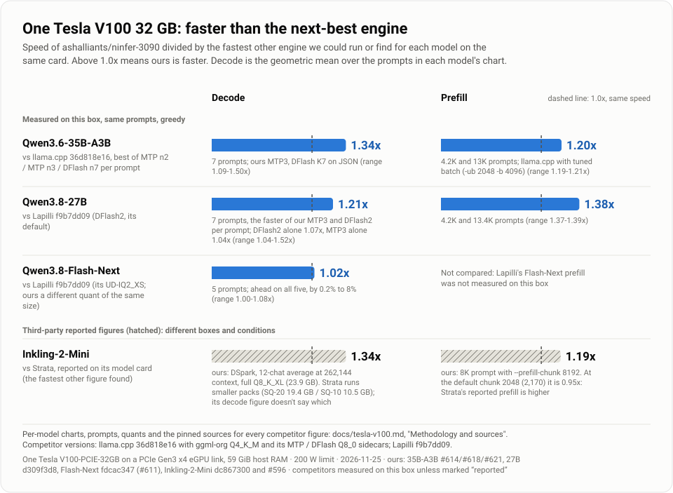
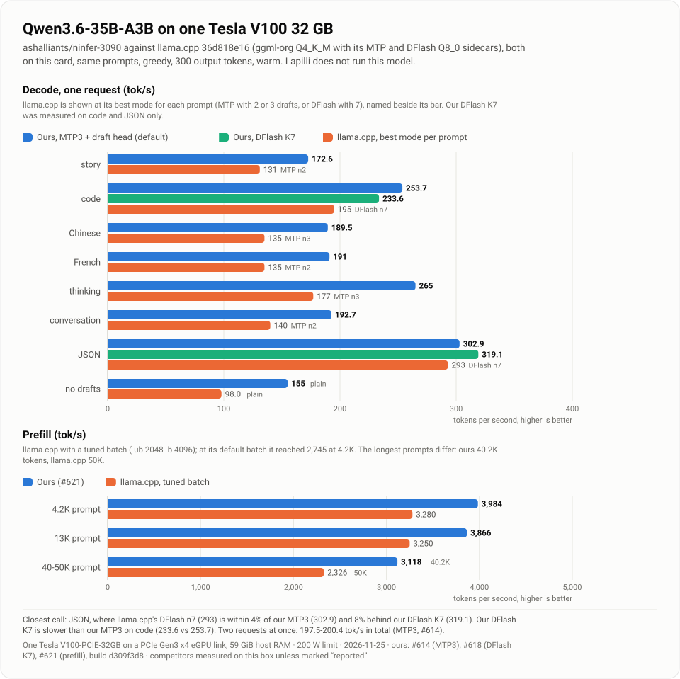
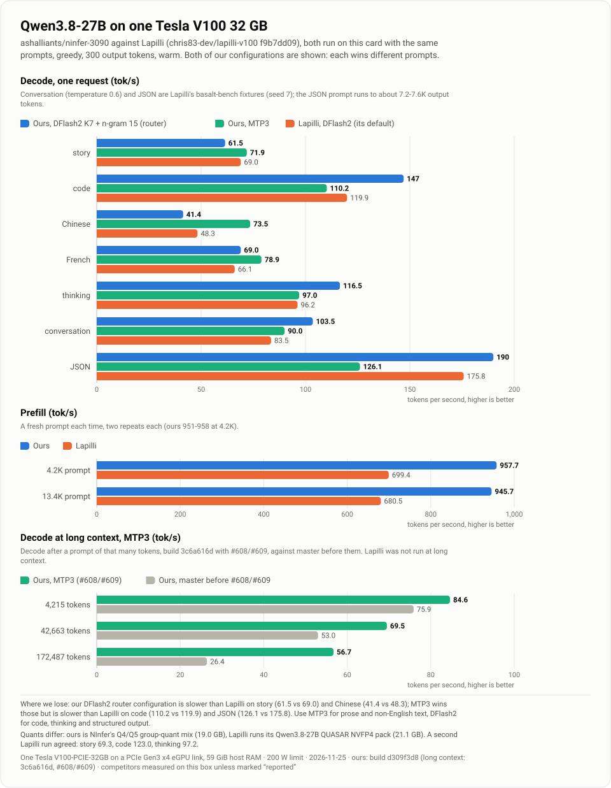
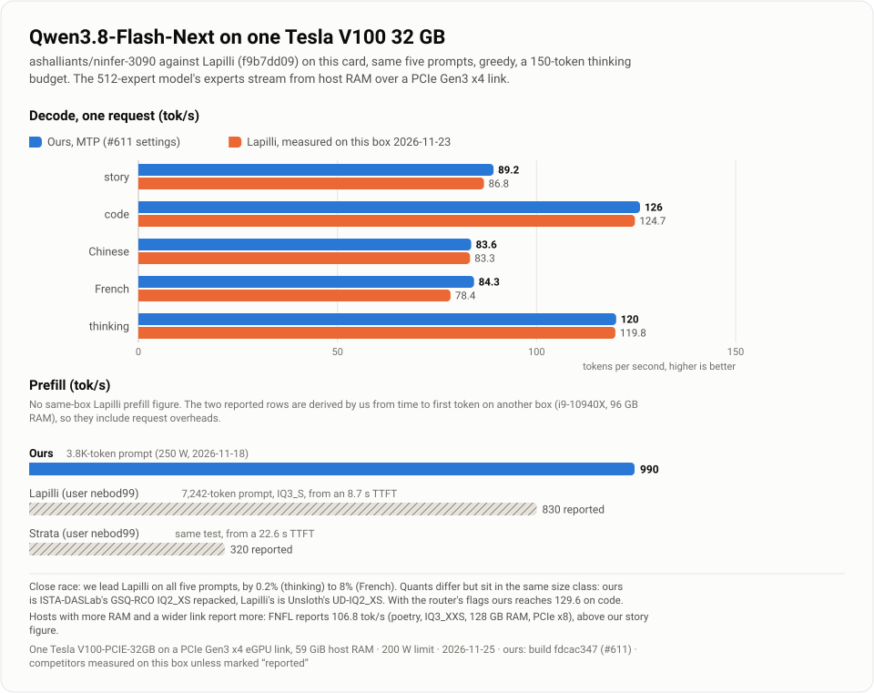
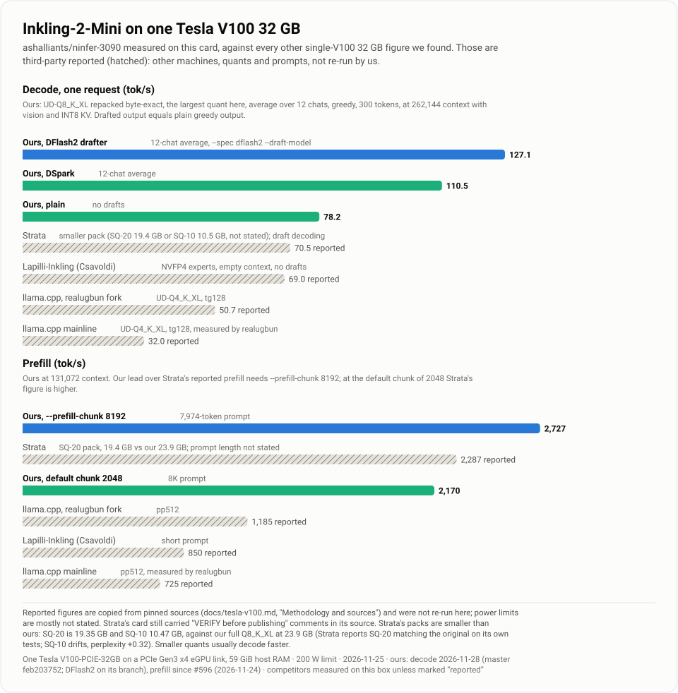

# NInfer on a Tesla V100

NInfer runs on a 32 GB Tesla V100 (Volta, `sm_70`), one of the project's two first-class cards
alongside the RTX 3090. Three models are supported and tuned there: **Qwen3.8-27B**,
**Qwen3.8-Flash-Next**, the 512-expert MoE with the full 262,144-token context, and
**Inkling-2-Mini**, the looped 128-expert MoE with images and DSpark speculative decoding
([spec and measurements](maintainer/inkling2-model.md)). This page covers what you need, how to build and run
the two Qwen models, their measured performance, and the limits; Inkling-2-Mini's run command and measurements
are in its [model card](../model-cards/Inkling-2-Mini-NInfer-V100/README.md) and its spec.
How the port works, and every measurement behind it, is in [docs/maintainer/volta-port.md](maintainer/volta-port.md).

Each release ships a prebuilt V100 archive for Linux, `ninfer-v100-linux-x64-<version>.tar.gz` (the 3090 archives are `sm_86` and do not start on a V100): unpack it, install the CUDA 12.8 runtime libraries and FFmpeg 6 it lists, and use its `run-v100.sh`. Or build from source on Linux, below.

## At a glance

All figures were measured on one V100-PCIE-32GB, connected over an OCuLink PCIe Gen3 x4 eGPU link
(3.3 GB/s host-to-device), on a Linux host with 59 GiB of RAM, with a 250 W power limit
(2026-11-16 to 2026-11-18), except the 27B's speculative decode, re-measured at 200 W on 2026-11-25 (master `d309f3d8`), and Flash-Next's MTP
decode, re-measured at 200 W on 2026-11-25.
Decode is greedy with MTP speculation, as `run-v100.sh` serves it (three drafts; seven for Flash-Next).

| | Qwen3.8-27B | Qwen3.8-Flash-Next |
|---|---:|---:|
| **Context** | 262,144 tokens | **262,144 tokens** (`run-v100.sh` default) |
| **Decode**, one stream, MTP | **147 tok/s** on code, 116.5 thinking, 190 structured JSON (DFlash2 K7 + n-gram 15, the router's setting); 110.2 code, 97.0 thinking, 71.9-78.9 story, Chinese and French (MTP3); master `d309f3d8`, 2026-11-25, 200 W | **129.6 tok/s** on code, 103-106 thinking, 82-83 story, 81 Chinese, 77 French (MTP7 + draft vocabulary, warm cache, 2026-11-25, 200 W) |
| **Decode**, plain | 45 tok/s (200 W) | 53 tok/s (250 W) |
| **Prefill**, ~4K-token prompt | **~1,020 tok/s** | **~990 tok/s** (3,798 tokens in 3.8 s) |
| **Prefill**, long prompts | | 38K tokens in 38.4 s (~1,000 tok/s) |

Flash-Next's decode does not slow down with context. From 10K to 221K tokens of context it stays at
27-29 ms per MTP verification round (69-79 tok/s on those prompts). What moves tok/s is how many
drafted tokens are accepted, which depends on the text, not on the context length.

**Inkling-2-Mini** on the same card (master `dad1623b`, 2026-11-22, 250 W limit, through `ninfer-serve`, except the
rows marked 200 W, re-measured 2026-11-23 (prefill 2026-11-24); the
[model card](../model-cards/Inkling-2-Mini-NInfer-V100/README.md) has the conditions and ranges):

| | Inkling-2-Mini |
|---|---:|
| **Context** | 262,144 tokens with DSpark and vision |
| **Decode**, one stream, DSpark | **up to 120.7 tok/s** (maths prompt); 93.4-94.4 average over 12 chats |
| **Decode**, plain | 80.6 tok/s at 8,192 (2026-11-28, 200 W; 80.1 before the cheaper NVFP4 decode); 48 tok/s at 100K context |
| **Decode at 262,144** (200 W) | **112.5 tok/s** DSpark (99.4 before the 2026-11-28 drafter changes; 108.9 before candidate picks; 110.5 before MXFP8 experts), **79.8** plain (78.2 before), average over 12 chats (`--max-context 262144 --vision --kv-dtype int8`) |
| **Decode**, DFlash2 drafter | **129.0 tok/s** at 262,144 (`--spec dflash2 --draft-model DIR`, vision, INT8 KV; 130.6 at 8,192), average over 12 chats; same output |
| **Decode**, `--max-concurrency 8` | **198.2 tok/s** aggregate (plain) |
| **Prefill** (200 W) | **2,727 tok/s** at 8K (131,072 context, `--prefill-chunk 8192`); 2,227 at 34K, 1,577 at 100K. At the default chunk 2048: 2,170 at 8K, 1,962 at 1K, 1,339 at 100K. At 262,144 with DSpark and vision (chunk 2048): 2,125 at 8K, 1,930 at 1K, 1,324 at 100K |
| **Low-bit KV** (`--kv-dtype rk4v4`, opt-in, lossy) | plain decode **41.1 tok/s at 200K** (FP16 34.8), 53.2 at 100K (47.8); frees 5,952 MiB at 262,144; KLD 2.8x the FP32 floor (`int8`: 1.06x, 40.7 tok/s) |
| **`--speed fast`** (opt-in, lossy) | **163.5 tok/s** on structured output (133.1 exact), **109.3-110.3** over 12 chats (101.1-101.3 exact); 2026-11-27, 200 W. With the 2026-11-28 drafter changes at 8,192 context: **117.4** over 12 chats (exact DSpark 109.6), maths 39/40, JSON 10/10 ([spec](maintainer/inkling2-model.md#speed-fast)) |
| **Load** | 9.2-14.2 s |

## Comparison charts

How NInfer (ashalliants/ninfer-3090) compares with the other engines that run these models on one
32 GB Tesla V100. Competitors were run on this box, with the same prompts, unless a bar is hatched and
marked "reported". Each chart's footnote names the build or PR behind its figures, and
[Methodology and sources](#methodology-and-sources) has the conditions and the pinned sources.
The charts are generated by `python tools/docs/v100_charts.py` from `tools/docs/v100_charts.json`.











## What you need

- **GPU:** a Tesla V100 with 32 GB. A 16 GB V100 has not been tried.
- **Host link:** any PCIe link works. The figures above come from a slow eGPU link (Gen3 x4, 3.3
  GB/s), and Flash-Next's prefill is partly bound by it. A full x16 slot (about 12 GB/s) should
  prefill faster; this has not been measured.
- **Toolkit:** CUDA 12.8 or 12.9. CUDA 13 dropped `sm_70`.
- **Qwen3.8-27B:** the 27B artifact and the card. Host RAM needs are modest.
- **Qwen3.8-Flash-Next:** about 64 GB of host RAM (the test host has 59 GiB). The experts (33 GiB) are pinned in RAM and
  cached in VRAM as they are used, so set the memory-lock limit high enough (`run-v100.sh` says how).
  The model takes about 39 GB on disk plus a 28 GB n-gram table, which is read from disk during
  prefill, so put it on an NVMe drive.
- **Cooling:** a V100 is passively cooled and needs real airflow. Sustained prefill holds it at its
  power limit. On the test box it peaked at 68 C over a 221K-token prompt. Watch `nvidia-smi -l 1`
  the first time on a new setup.

## Build

```bash
scripts/v100_build.sh ninfer ninfer-serve
```

`scripts/v100_build.sh` builds in `build-v100/` inside the checkout (set `BUILD_DIR` to move it).
Each worktree gets its own tree, and ccache shares objects between them. It configures with
`-DCMAKE_CUDA_ARCHITECTURES=70` (machine code only: a V100 never runs PTX, so the build leaves it
out; see `NINFER_CUDA_PTX` in `docs/maintainer/build-system.md`), uses ccache, and limits
parallel compile jobs to fit the host's RAM. One `nvcc` job can peak at 1.5-2 GiB. Set
`NINFER_BUILD_TESTS=1` to configure the tests as well.

## Run

```bash
scripts/run-v100.sh qwen38-flash-next     # or: scripts/run-v100.sh qwen38-27b
scripts/run-v100.sh qwen36-35b-a3b        # Qwen3.6-35B-A3B, text and images
```

`run-v100.sh` finds the `sm_70` server in `build-v100/` (or uses `NINFER_SERVER`), checks that the
card is a V100 with nothing else running on it, and starts `run.sh` with the V100's measured
defaults. Every `NINFER_*` variable you set still wins.

The server listens on every interface (`0.0.0.0`), so other machines on the network reach it at
`http://<this machine's IP or host name>:8080`. Set `NINFER_API_KEY` as well: without a key,
anyone who can reach the port can use the model, and the launcher and server both warn about it.
`NINFER_HOST=127.0.0.1` keeps it local to this machine.

### Running Qwen3.6-35B-A3B

```bash
scripts/download-model.sh qwen36-35b-a3b   # 21.2 GiB, resumable
scripts/run-v100.sh qwen36-35b-a3b
```

This serves `run.sh`'s `tuned` profile for the 35B (`scripts/profiles/qwen36-35b-a3b-tuned-mtp.json`:
`rk4v4` KV, MTP3 with the draft head and Q4 MTP experts, FP16 GDN state, cuBLAS prefill at chunk
4096) with two V100 changes: two lanes, and the Vision tower **resident** in VRAM. Overlay
residency (`run.sh`'s default) fails at startup on this model, because an encode window needs 2,256
MiB of evict-ranked weights and the 35B has only 1,552 MiB, so the launcher refuses
`NINFER_VISION_RESIDENCY=overlay` before starting. Resident fits beside the full context.

Checked through the launcher on master `d309f3d8e` (2026-11-25, 200 W): startup took 23 s and fitted
the full 262,144-token context (`KV 262,144 tokens, rk4v4`, 7.2 GiB still free). A code prompt decoded at 280-290 tok/s
(greedy, 265-300 tokens), and an image request (a 1024 x 1024 test card, 1,063 prompt tokens, 1.3 s
TTFT) read the label and described the shape correctly. The decode figures by prompt type are under
[Performance](#qwen36-35b-a3b).

These are the model defaults it sets:

| Setting | Model | Effect on the V100 |
|---|---|---|
| `NINFER_CONTEXT=262144` | Flash-Next | Serves the full context. The KV cache starts at 496 MiB and takes VRAM from the expert cache only as a conversation grows, up to 3.6 GiB at 256K tokens |
| `NINFER_SM70_TENSOR_CORES=1` | Flash-Next | Prefill linears and prompt attention run on the FP16 tensor cores: a 3.9K-token prompt goes from 6.9 to 6.0 s. Output is close to the plain server's but not bit for bit |
| `NINFER_PREFILL_CPU_ALL_COLUMNS=1024`, `NINFER_PREFILL_CPU_MAX_COLUMNS=64`, `NINFER_PREFILL_CPU_SHARE=0.5` | Flash-Next | The CPU computes prefill experts that are not cached on the GPU and used by only a few tokens, instead of copying them over the link. Same output |
| `NINFER_NGRAM_RAM_MIB=auto` | Flash-Next | Keeps about half the n-gram table (13 GiB on a 59 GiB host) in RAM after the experts and context cache are sized, which halves a prompt's disk reads |
| `NINFER_MTP_STAGED_DRAFTS=on` | Flash-Next | Drafts one token at a time and stops when no further draft could be accepted: up to +3.6% decode (story, Chinese, French; code unchanged), same output |
| `NINFER_CPU_VERIFY_MISSES=on` | Flash-Next | During decode, experts that miss the cache are computed on CPU threads beside the GPU. A cold cache decodes at 68-80 instead of 48-63 tok/s |
| `NINFER_PARTIAL_RAM_RESIDENCY=on` | Flash-Next UD-IQ3_XXS | Pins only the experts the VRAM cache does not hold (`--partial-ram-residency`), so the 42 GiB bank fits; no images, context 32,768. `off` pins every expert (about 50 GiB) and restores images and the 262,144-token context |
| `NINFER_HOT_EMBEDDING_ROWS=8192` | Flash-Next | Only the common embedding rows stay in VRAM, freeing room for 216 more cached experts |
| `NINFER_SPEC=mtp`, `NINFER_KV_DTYPE=int8` | 27B | MTP3 with INT8 KV: on this card it beats DFlash2 (`--draft-tokens 7`) on story, Chinese and French (71.9 / 73.5 / 78.9 tok/s against 61.5 / 41.4 / 69.0); DFlash2 with `--ngram-draft-tokens 15` wins on code (147.0 against 110.2 tok/s), thinking (116.5 against 97.0) and long structured output (190.0 against 126.1). Master `d309f3d8`, 2026-11-25, 200 W; see [Methodology and sources](#methodology-and-sources) |
| `NINFER_VISION_RESIDENCY=resident` | 35B-A3B | Keeps the Vision tower in VRAM. `run.sh`'s overlay residency does not work for this model on the V100: the server refuses to start ("needs 2256 MiB of evict-ranked weights ... provide 1552 MiB"), so the launcher refuses `NINFER_VISION_RESIDENCY=overlay` before starting. `NINFER_VISION=off` serves text only |
| `NINFER_CONCURRENCY=2` | 35B-A3B | Two lanes sharing one 262,144-token `rk4v4` KV pool (`run.sh` gives the 3090 three) |
| `NINFER_GGML_STAGED=0` | Flash-Next | Returns the GGML dense linears' verify GEMVs (2-8 columns) to the kernel that casts the input in every CTA, instead of the default staged route that casts it once per call: the same output, about 2% slower decode on code |
| `NINFER_DRAFT_A8=0` | 27B, DFlash2 | Runs the DFlash2 drafter's linears on its A16 kernels instead of the default int8-activation `dp4a` route: about 9 ms slower per K = 7 round, the same acceptance on most measured prompts |
| `NINFER_SM70_VERIFY_ATTN_HMMA=0` | 27B | Runs the INT8-KV small-T attention on the CUDA-core kernels (two-token launches for a verify) instead of the default FP16 tensor-core kernel: an MTP3 round at 172K tokens takes 110 ms instead of 52, at 43K 50 instead of 36 |
| `NINFER_SM70_Q6_STREAM_WIDE=0` | 27B, DFlash2 | Runs the Q6 output head of a verify wider than eight columns (DFlash2 at two requests, or `--draft-tokens` 8-15) on the emulated `mma.sync` kernel instead of the default int8-activation `dp4a` passes of eight: 9.9 instead of 2.6 ms per 16-column round |
| `NINFER_SM70_Q8_PREFILL_CUBLAS=0` | 35B-A3B | Prefills the Q8 mixer projections (GDN and attention input projections, both 2,048 x 4,096 output projections) on their emulated `mma.sync` kernels instead of the default cuBLAS FP16 route: 1,160 instead of 2,411 tok/s at 4.2K tokens |
| `NINFER_SM70_FLASH_PACKED_KV=0` | 27B, 35B-A3B | Runs prompt attention (17 or more columns, one sequence) over an `rk8v4` or `rk4v4` cache on the emulated FA2 prompt kernel instead of the default FP16 flash route that `int8` KV takes: 35B-A3B 1,098 instead of 3,117 tok/s at 40.2K tokens |
| `NINFER_SM70_MOE_PREFILL_SHARED_HMMA=0` | 35B-A3B | Prefills the shared expert (Q8 gate/up and down) on its emulated `mma.sync` kernels instead of the default FP16 WMMA kernels: 2,402 instead of 2,836 tok/s at 4.2K tokens |
| `NINFER_SM70_MOE_PREFILL_HMMA=0` | 35B-A3B | Prefills the routed experts (Q4 gate/up, Q5/Q6 down) on the emulated `mma.sync` kernels instead of the default FP16 WMMA kernels: 765 instead of 1,160 tok/s at 4.2K tokens |
| `NINFER_SM70_Q8_VERIFY_A8=0` | 35B-A3B | Runs the Q8 mixer projections of an MTP3 verify (the GDN and attention input projections, 12,288 and 9,216 x 2,048, and the 2,048 x 4,096 output projections) on the A16 streaming GEMV instead of the default int8-activation `dp4a` passes under `--verify-a8`: 5-14% slower MTP3, decode-path KLD at four tokens 2.71e-3 instead of 3.37e-3 |
| `NINFER_SM70_VERIFY_PROMPT_ATTN=1` | 35B-A3B | Lets a DFlash or MTP verify of 6-16 columns take the FA2 prompt attention kernel at short contexts (its RTX 3090 limits, up to 288-1,024 keys) instead of the default small-T routes; the prompt kernel is emulated `mma.sync` on Volta: DFlash K7 structured JSON 293 instead of 319 tok/s |
| `NINFER_SM70_Q6_35_STREAM=0` | 35B-A3B | Runs the Q6 output head of a 2-32-column call (an MTP3 verify) on the emulated `mma.sync` sliced-K kernels and the one-token call on the A16 GEMV, instead of the default streaming GEMV (int8-activation `dp4a` passes of eight under `--verify-a8`): 4.1 instead of 0.5 ms per MTP3 verify |

One default comes from the build rather than the launcher: in an `sm_70` build `--prefill-cublas` is
on, so the 27B's wide prefill GEMMs run on the tensor cores through cuBLAS instead of emulated integer
kernels. For Inkling-2-Mini it moves the tensor-core prefill's loop controllers and router to cuBLAS
SGEMM (FP32) and each chunk's busiest experts (512 or more routed positions) to FP16 cuBLAS GEMMs on
exactly decoded weights: through the server at 8K and the default chunk, 2,069 tok/s against 1,893
(+9%, 200 W); on the program at chunk 8192, +21% (2,514 against 2,082). Layers 20-23's BF16-bank experts
with fewer than 512 positions then moved from per-expert cuBLAS calls onto the tensor-core kernels: at the
default chunk 2,170 tok/s at 8K against 2,071, 1,962 against 1,807 at 1K and 1,339 against 1,300 at 100K
(131,072 context, 200 W, 2026-11-24), with the same KLD. `--no-prefill-cublas` (`NINFER_NO_PREFILL_CUBLAS=1`) turns it off.

Inkling-2-Mini's prefill chunk stays 2048 by default, because prefix reuse resumes a chat at a multiple
of the chunk: a second turn at 8K answers in 1.03 s at chunk 2048, 1.77 s at 4096 and 3.04 s at 8192.
For long single-shot prompts, `--prefill-chunk 4096` or `8192` is the throughput setting (2,227 tok/s
at 34K at chunk 8192; chunk 4096 gave 2,004 before the BF16-bank change and was not re-measured). Chunk
8192 needs 1,746 MiB of workspace (chunk 4096 needed 872 before that change): at 262,144 with DSpark and
vision they fit with `--kv-dtype int8`, not with the default FP16 KV.

### Profiling with nsys

**Set `NINFER_NO_COOPERATIVE_KERNELS=1` when running under `nsys` on `sm_70`.** Under Nsight Systems
on a V100, kernels launched cooperatively (ones that synchronize their whole grid) can fault with
`cudaErrorInvalidPc`, on master too. With nsys 2025.1.3, a 97-token prompt to the 35B aborted that
way (reported later, at an unrelated `CUDA_CHECK`); with the variable set, the same run completed. The Qwen3.6-35B-A3B uses such kernels for its GDN gating
projection (the split-K `MmaCooperativeSplit*` schedules) and for the fused norm-gating route of
calls up to 16 tokens, so its profiles can fail without this variable (other widths, such as a
1K-token prompt, profiled cleanly; set it for reliable profiles). With it set, those calls
take their non-cooperative schedules instead (`MmaUnsplit`, and the composed norm then gating):

```bash
NINFER_NO_COOPERATIVE_KERNELS=1 nsys profile -o 35b --trace cuda,nvtx \
  build-v100/apps/ninfer ~/models/qwen3_6_35b_a3b.ninfer --max-context 8192 --kv-dtype rk4v4 \
  --spec mtp --draft-tokens 3 --lm-head-draft --mtp-experts-q4 --gdn-state-fp16 \
  --prefill-chunk 4096 --greedy --max-new 32 --prompt "$(cat prompt-1k.txt)"
```

It is off by default and read once at startup. It works on every card (on an RTX 3090 it only
moves those calls to the slower schedule) and changes nothing else. The non-cooperative schedules
sum the split-K partials in a different order, so the output can differ in the last bits and those
calls are slower: leave it unset for timing and for bit-identity checks, and correct the gating
kernels' share of a profile by their op bench (`ninfer_tests ninfer_gdn_gating_proj_test`).

### Refusal steering (Flash-Next)

The community refusal-direction vector for Qwen3.8-Flash-Next ships in the Strata repository as
[`data/experimental-speed-projection/Qwen3.8-Flash-Next-experimental-speed-projection.gguf`](https://github.com/Niko1221/Strata/tree/main/data/experimental-speed-projection),
480 KB. Strata presents it as an off-by-default "experimental speed projection", but its README
says what it is: a refusal-direction projection that makes the model decline far fewer requests,
removing a safety behaviour. The Qwen Community License of the model applies to it.

The file holds directions for layers 1-47, but its authors apply only layers 4-44 (`layer_range`
in the JSON beside it; their scores are for that range). `--graft` applies every direction in the
file, so make a copy with only those layers, then load it:

```bash
python3 tools/control_vector_layers.py Qwen3.8-Flash-Next-experimental-speed-projection.gguf \
    flash-next-refusal-L4-44.gguf --first 4 --last 44
NINFER_GRAFT="uncensored=$PWD/flash-next-refusal-L4-44.gguf" scripts/run-v100.sh qwen38-flash-next
```

A request then opts in with `"graft": "uncensored"`. `NINFER_DEFAULT_GRAFT=uncensored` applies it to
every request that names no graft, and a request opts out with `"graft": ""`. On the V100,
`ninfer_qwen4_exp_steering_real_test` passes with this copy, and a steered request gives a
different answer from the same unsteered one (2026-11-18). Loaded, the vector costs about 50 us
per token even for requests that do not select it; with no vector loaded, nothing changes.

With the vector on, the model can reason for a long time about a prompt it would otherwise refuse,
and at temperature 0 it can loop in its reasoning. On the V100 (2026-11-19), two such prompts at
temperature 0 reasoned to a 12,000-token limit repeating the same few lines; sampled at
temperature 0.6 they answered after 3,200-7,500 tokens (44-99 s). Narrowing the vector's layer
range did not stop the loops. Three settings did, each request answering without a refusal:

- **A presence penalty** of 1.0 (`NINFER_PRESENCE_PENALTY=1.0`) broke the loop on its own: the same
  temperature-0 request then answered after 2,742 thinking tokens.
- **A thinking cap** (`NINFER_DEFAULT_THINKING_BUDGET=1024`) bounds the time: those prompts then
  answered in 16-25 s, at temperature 0 and 0.6. It caps every request; a request can raise it with
  `"thinking_budget"`.
- **The reasoning-loop guard** (`NINFER_REASONING_LOOP=conclude`) is a backstop. It did not need
  to fire once the presence penalty was set.

```bash
NINFER_GRAFT="uncensored=$PWD/flash-next-refusal-L4-44.gguf" NINFER_DEFAULT_GRAFT=uncensored \
NINFER_PRESENCE_PENALTY=1.0 NINFER_DEFAULT_THINKING_BUDGET=1024 NINFER_REASONING_LOOP=conclude \
NINFER_TEMPERATURE=0.6 NINFER_TOP_P=0.95 NINFER_TOP_K=20 scripts/run-v100.sh qwen38-flash-next
```

### Refusal steering (Qwen3.8-27B)

The 27B loads the GLP control vector
[`BlivionIaG/Qwen3.8-27B-refusal-cvec-GLP-49`](https://huggingface.co/BlivionIaG/Qwen3.8-27B-refusal-cvec-GLP-49)
(`Qwen3.8-27B-refusal-cvec-GLP-49-L10-58-a1.gguf`, 1 MB: project mode, layers 10-58, alpha 1) as a
`--graft` ([serving.md](serving.md#control-vectors-on-the-dense-models)); it combines with the pi
LoRA (`"graft": "uncensored", "lora": "pi"`). Measured on the V100 (2026-11-20, `--spec mtp`,
INT8 KV, greedy unless stated):

- **Refusals.** Four prompts the base model refuses outright (hotwiring a 1992 Civic, defeating
  supermarket security tags, cheating on an exam, a news paywall): with the vector none opens with
  a refusal. The hotwiring prompt gets step-by-step instructions; the paywall prompt mostly legal
  routes (with pi, also a cookie-clearing tip); the tag and exam prompts are redirected to the
  legitimate process or to preparation rather than refused. The pi adapter alone changes none of the
  refusals, and vector + pi behaves like the vector. A benign prompt (how a fridge works) stays
  coherent in every combination.
- **Thinking.** With thinking on, the steered hotwiring prompt reasoned to a 6,000-token limit
  without answering at temperature 0 and 0.6 (no verbatim loop; with or without pi). With the
  router's 27B sampling (presence penalty 0.5, min-p 0.03) and `thinking_budget` 2048 it answered
  with steps in 47-55 s at both temperatures; the tag prompt answered in 30-38 s.
- **Speed** (300-token decode, 3,067-token prefill, three cooled repetitions): base 65.2 tok/s
  decode, 1,150 tok/s prefill on a server without the vector; base 64.9 / 1,150 with the vector
  loaded (the same tokens and MTP acceptance); steered 62.1 / 1,145 (MTP acceptance 0.51 against
  the base's 0.55 on its different text); pi 58.8 / 1,035; vector + pi 57.3-60.4 / 1,030.

```bash
NINFER_GRAFT="uncensored=$HOME/models/vectors/Qwen3.8-27B-refusal-cvec-GLP-49-L10-58-a1.gguf" \
NINFER_DEFAULT_THINKING_BUDGET=2048 scripts/run-v100.sh qwen38-27b
```

## Performance

### Qwen3.8-27B

Current figures: decode, one stream, the same prompts and router flags, master `d309f3d8`, 2026-11-25,
**200 W** (the run behind the comparison charts and the summaries above):

| Prompt | MTP3 | DFlash2 K7 + n-gram 15 |
|---|---:|---:|
| code | 110.2 | **147.0** |
| think | 97.0 | **116.5** |
| story | **71.9** | 61.5 |
| Chinese | **73.5** | 41.4 |
| French | **78.9** | 69.0 |
| structured JSON | 126.1 | **190.0** |

The table below is the earlier 2026-11-24 ABBA record of the int8-activation DFlash2 drafter
(#605); it is kept for its before/after columns and is the source of the plain and two-request
figures, which were not re-measured on 2026-11-25.

Decode, one stream, through `ninfer-serve` with the router's flags (`--gdn-state-fp16
--prefill-cublas`, INT8 KV, vision overlay), greedy unless noted, 2026-11-24, **200 W** power limit,
no thermal throttling. DFlash2 runs `--draft-tokens 7 --ngram-draft-tokens 15`, plus
`--adaptive-draft-tokens 3` where marked. The current columns are ABBA against the same build with
`NINFER_DRAFT_A8=0` (the drafter on master's kernels); repeats agreed within 0.2 tok/s:

| Prompt | MTP3 | DFlash2 K7 | DFlash2 K7 adaptive | DFlash2 K7 before | MTP3 before `--verify-a8` |
|---|---:|---:|---:|---:|---:|
| code | 110.0-110.1 | **135.5-135.7** | 135.4-135.6 | 110.5-111.3 | 81.2-82.1 |
| think | 104.0 | **125.0-125.2** | 125.1-125.2 | 102.3-103.0 | 77.2-77.9 |
| story | **76.9** | 60.6-60.7 | 60.7 | 52.5-52.8 | 57.0-57.7 |
| Chinese | **81.3-81.4** | 39.7 | 51.2 | 32.4-32.6 | 57.2-57.8 |
| French | **80.6** | 68.3 | 72.9-73.0 | 55.6-56.0 | 57.2-57.6 |
| conversation (T 0.6) | **91.4-91.5** | 85.7 | 81.3-81.4 | 75.0-75.3 | 65.9-66.1 |
| structured JSON | 122.5 | **176.9-177.0** | 176.6 | 146.3-146.6 | 92.3-92.5 |
| prose (T 0.6) | **80.4** | 69.5 | 77.3-77.4 | 56.5 | 58.0-58.1 |
| conversation, greedy | 89.4 | 90.4 | **91.3** | 71.7-71.8 | 68.5-68.6 |
| plain decode (no speculation) | 45.0 | | | | 42.7-43.0 |
| two requests at once (story + code, 256 tokens each), total | **122.0-122.8** | | | | 74.0-74.2 |

So DFlash2 K7 is the fastest setting on code, thinking and structured output, and MTP3 on story,
Chinese, French and sampled prose and conversation. The prompts are the five 300-token ones (code,
think, story, Chinese, French) and Lapilli's basalt-bench fixtures (seed 7). The plain, two-request
and `MTP3 before` figures are from the `--verify-a8` change (ABBA against master `2a1bf0353`).
`ninfer_bench -pg 2048,256` (bench corpus, INT8 KV, 93-95% acceptance): MTP3 **118.9** (88.0 before
`--verify-a8`), DFlash2 K7 141.9 (93.2), plain 43.8 (41.9-42.0). Deeper MTP windows pay only on code
and structured output: MTP5 117.4 code and 148.0 structured, MTP7 158.1 structured, but every other
prompt is slower, so MTP3 stays the default.

DFlash2's gain is its drafter: in an `sm_70` build the block drafter's own linears (the Q8 attention
input, SwiGLU, output and down projections at eight columns, and the Q4 proposal head) round their
activations to int8 per 32 values and run `dp4a` instead of emulated `mma.sync` kernels, about 9 ms
less per K = 7 round. The target still verifies every draft: acceptance on most prompts above is
unchanged at K = 7 (code 246 of 371 drafts with and without it), and greedy text is identical on
code, thinking, Chinese, French and structured output. Story and a long reply part at a near-tie, as
they also do on master between DFlash2 window settings, because a verify round's arithmetic depends
on its width. `NINFER_DRAFT_A8=0` turns it off. Details in
[volta-port.md](maintainer/volta-port.md#decode).

DFlash2 rounds wider than eight columns (two requests at once at K = 7, or K = 8-15 on one) used to
run the target's Q6 output head (248,320 x 5,120) on an `mma.sync` kernel emulated on Volta: 9.9 ms
of a 16-column round. It now runs as `dp4a` passes of eight columns on int8 activations, 2.6 ms, and
each column's logits equal what the head computes for that token alone. Two requests at once on
DFlash2 K7 (story + code, 256 tokens each) total **94.6-96.0 tok/s** instead of 89.3-90.9, and K = 15
on one request is 9.6-9.9% faster where its text is unchanged (code 101.8 against 92.4-92.7,
structured 180.8 against 164.8-164.9; also Chinese and French), though K = 7 stays the
faster window (structured 191.2-191.9 in the same session). Decode-path KLD at a 16-token window is
7.0e-4 against master's 6.2e-4 (98.8 against 98.9% the same top-1), the int8 head's own class (6.2e-4
at one and eight tokens on the same text). MTP3 and one-request DFlash2 K7 verify at most eight
columns and are unchanged. `NINFER_SM70_Q6_STREAM_WIDE=0` restores the old head. Details in
[volta-port.md](maintainer/volta-port.md#decode).

The target's own speed-up behind the MTP3 and plain columns is `--verify-a8`, on by default in an
`sm_70` build: the Q4/Q5/Q6 linears at 1-8 tokens
round their activations to int8 per 32 values and run `dp4a`, so a verify round costs about the same
as a plain step's GEMVs at any width (`--no-verify-a8` turns it off). It is lossy at the noise floor:
on a decode-path KLD gate against the FP32 kernels (17 chunks of 512 tokens from four held-out
domains), KLD 7.2e-4 to 7.8e-4 at one, four and eight tokens, and 98.9-99.2% the same top-1 token;
master's own verify reordering measures 3.8e-4 and 99.4%. Greedy text therefore differs from master
at near-ties (MTP3's code and structured outputs above are byte-identical to master's). Details in
[volta-port.md](maintainer/volta-port.md#decode).

The weights alone take 17.4 ms per token to read at the card's measured 879 GB/s, so plain decode
can reach at most about 57 tok/s; speculation gets past that ceiling. Prefill runs its GEMMs on the
tensor cores through cuBLAS, and prompt attention through FP16 flash attention. 1,150 / 2,186 /
4,392-token prompts prefill at 868 / 959 / 1,020 tok/s.

Decode against context length, the same server flags, 256 greedy tokens (`ignore_eos`) on exact-hit
repeats of a checkpointed prompt (Project Gutenberg text from the PG-19 corpus plus a question), one
request at a time (2026-11-25, 200 W, no thermal throttling, against master `96b14bca`, which has
#609's split fix; MTP3 ABBA with three repeats per leg, the legs of each side within 0.05 tok/s;
DFlash2 one leg each; plain from the same build pair on 2026-11-24):

| Context | MTP3 | master | DFlash2 K7 | master | plain | master |
|---:|---:|---:|---:|---:|---:|---:|
| 4,215 | 84.6-84.7 tok/s | 75.9 | **85.4** | 62.3-62.5 | 43.7 | 43.7 |
| 42,663 | **69.5-69.6** | 53.0 | 50.4 | 37.3 | 36.1 | 34.6 |
| 172,487 | **56.7** | 26.4 | 34.9 | 14.0 | 24.1-24.2 | 20.7 |

Per speculative round (generation time over rounds, a round emitting its accepted drafts plus one):

| Context | MTP3 | master | DFlash2 K7 | master |
|---:|---:|---:|---:|---:|
| 4,215 | 31.4 ms | 32.3 ms | 40.9 ms | 44.0 ms |
| 42,663 | 36.3 ms | 50.1 ms | 48.2 ms | 75.9 ms |
| 172,487 | 52.3 ms | 109.6 ms | 71.0 ms | 184.6 ms |

Long-context decode was attention over the 16 full-attention layers' INT8 KV, and on this card a
speculative verify used to run it as two-token CUDA-core launches that each re-read the whole cache.
It now runs on the FP16 tensor cores in one launch per layer (`NINFER_SM70_VERIFY_ATTN_HMMA`, on by
default in an `sm_70` build; `=0` restores the old kernels): an MTP3 round at 172K costs 52 ms
instead of 110, and a DFlash2 K7 round 71 ms instead of 185; MTP3 decodes 2.1x faster there and
DFlash2 2.5x. Three- and four-column verifies take it from 1K keys, two columns from 6K and one
column (plain decode, the MTP drafter) from 20K, so plain decode is 17% faster at 172K (24.2 against
20.7 tok/s) and the same at 4K. The change is lossy at the noise floor: on a decode-path KLD gate
over 16-32K-token contexts it is as far from the FP32 reference as master's own verify reordering
(KLD 6.2e-4 against 6.2-6.4e-4, 98.8-98.9% the same top-1 token), so greedy text parts from master's
at near-ties. In this run every context's text differs from master's in its wording (at 172K both
summarise the same section), and acceptance moved with the text (MTP3 at 172K: 170 of 254 drafts
against 168 of 259), so the per-round times are the like-for-like measure. (Master before #609 ran
past its page-id table at 172K, so its 20.9 / 10.8 tok/s there were not a valid baseline.) At 4K
most of the gain is that acceptance change: MTP3's round is 3% cheaper and DFlash2's 7%, against 12%
and 37% more tok/s. Details in [volta-port.md](maintainer/volta-port.md#decode). (The previous
figures, 57.9 / 47.9 / 25.0 tok/s at 4,170 / 40,259 / 162,152 tokens on 2026-11-23, used a different
prompt.)

**Per-layer KV mixes** (`--kv-dtype rk4v4x12,int8x4` and the like, opt-in, lossy). Same server
flags, only `--kv-dtype` varied, 200 W, interleaved legs (2026-11-23; the paired legs agreed within
0.1%). These ran before `--verify-a8`, so their decode columns are master's. Perplexity is the held-out corpus at a 65,536-token context; ΔNLL is the paired difference
from `int8` in millinats (se over 6 domains):

| KV | Bytes/token | ΔNLL vs `int8` | Decode 4K / 40K / 162K | Prefill 40K / 162K |
|---|---:|---:|---|---:|
| `int8` | 33,792 | — | 57.9 / 47.9 / 25.7 tok/s | 47.0 s / — |
| `rk4v4x4,int8x12` | 29,824 | −0.13 (se 0.36) | 60.0 / 48.4 / 24.4 tok/s | 61.1 s / 535 s |
| `rk4v4x12,int8x4` | 21,888 | +1.69 (se 0.47) | 63.6 / 43.5 / 20.9 tok/s | 89.5 s / 975 s |
| `rk4v4` | 17,920 | +3.56 (se 0.58) | 58.4 / 42.2 / 20.3 tok/s | 103.6 s / 1,194 s |

The `int8` legs' 162K prefills overlapped a thermal pause and are not given. The last four
full-attention layers are the sensitive ones, so a little `int8` there buys back most of `rk4v4`'s
loss. On this card `int8` stays the right choice (it fits 262K at two lanes with 5.2 GiB free and
prefills fastest); the mixes are for when KV bytes are short. See
[the README](../README.md#per-layer-mixes---kv-dtype-rk4v4x12int8x4-opt-in).

### Qwen3.8-27B, NVIDIA's NVFP4 QAD checkpoint

[nvidia/Qwen3.8-27B-NVFP4-QAD](https://huggingface.co/nvidia/Qwen3.8-27B-NVFP4-QAD) is NVIDIA's
quantization-aware-distilled mix: NVFP4 MLP, `lm_head` and most GDN projections, FP8 attention and
the rest of GDN. Convert it with the `qwen3_8_27b_nvfp4_qad` recipe
([weight conversion](weight-conversion.md)). The V100 has no FP4 or FP8 hardware, so NInfer runs it
on routes that widen the weights exactly in software:

- **Decode and short prompts (1-64 tokens):** NVFP4 codes become int8 by a byte permute and run on
  the same dp4a streaming GEMV as the Q4/Q5 mix up to 8 tokens (`--verify-a8`, on by default), and
  on its streaming tensor-core tiles from 9 to 64, reading the 4-bit weights directly. FP8 runs
  2-64 tokens on those tiles too, its codes widened to FP16 bit for bit.
- **Longer prompts (65+ tokens):** NVFP4 and FP8 weights are expanded to FP16 and multiplied by
  cuBLAS on the tensor cores, the route the Q8 projections already take.
  `NINFER_SM70_FP_PREFILL_CUBLAS=0` turns it off.

Same binary, `apps/ninfer` single request (not serve-level), no drafter, BF16 KV, 200 W, two repeats
per leg agreeing within 0.5% (2026-11-26; no thermal throttle sampled):

| Artifact | Weights | Prefill, 3,754-token prompt | Decode after it | Decode, 22-token prompt | Prefill, 22-token prompt |
|---|---:|---:|---:|---:|---:|
| Q4/Q5 mix (`qwen3_8_27b`) | 14.6 GiB | 741.9 tok/s | 40.3 tok/s | 42.2 tok/s | 206.0 tok/s |
| NVFP4 QAD | 15.9 GiB | 745.8 tok/s | 38.9 tok/s | 40.6 tok/s | 203.6 tok/s |

Before these routes, the QAD artifact decoded at 8.6 tok/s and prefilled the long prompt at about
25 tok/s. Short prompts now match the Q4/Q5 mix: with a plain template, 11 / 18 / 28 / 47 prompt
tokens prefill at 184.8 / 235.8 / 324.2 / 305.6 tok/s against its 189.6 / 229.8 / 315.0 / 324.1.

**Serving it.** `download-model.sh qwen38-27b-qad`, then `run-v100.sh qwen38-27b-qad`: MTP3 (or
DFlash2, below) with the draft head, INT8 KV, two lanes sharing the full 262,144-token context,
vision in overlay residency. It starts with 3.9 GiB of VRAM free. Speculation stays on because overlay vision borrows its encode
window from the MTP weights (`NINFER_SPEC=none` is refused rather than started without images).
`ninfer-serve` on 127.0.0.1, MTP3, INT8 KV, `--prefill-cublas --prefill-chunk 2048 --gdn-state-fp16`,
greedy, thinking off, 400-token answers, 200 W (2026-11-26):

| Prompt | NVFP4 QAD | Q4/Q5 mix, MTP3 (2026-11-24) |
|---|---:|---:|
| Code (ISO 8601 parser with tests) | 90.0 tok/s | 110 tok/s |
| Story | 59.0 tok/s | 77 tok/s |

**DFlash2 (artifact revision 2026-11-27).** The artifact now also carries the Q4/Q5 build's DFlash2
drafter, copied byte for byte (`tools/artifact/add_component.py`; MTP output on the five prompts below
is byte-identical to the first revision's). `NINFER_SPEC=dflash2 run-v100.sh qwen38-27b-qad` serves it
as K=7 with n-gram copies. Same server settings as above (two lanes, INT8 KV, overlay vision), greedy,
thinking off, 400-token answers, one request at a time, 2026-11-27, 200 W, ABBA, the two legs of each
column within 1 tok/s; the Q4/Q5 column is one run of the same settings:

| Prompt | QAD, MTP3 | QAD, DFlash2 K=7 + n-gram | Q4/Q5 mix, DFlash2 K=7 + n-gram |
|---|---:|---:|---:|
| Code (ISO 8601 parser with tests) | 90.1-91.1 | **116.0-116.4** | 139.1 |
| JSON list | 93.2-94.1 | **114.6-114.8** | 151.3 |
| Explanation (TCP) | **66.5-67.1** | 63.6-63.7 | 84.3 |
| Story | **58.5-59.0** | 49.1-49.3 | 63.4 |
| French essay | **58.0-58.4** | 46.7-46.9 | 59.7 |

The drafter was trained against the BF16 model, and on this checkpoint it drafts predictable text well
and prose worse than on the Q4/Q5 mix, so MTP3 stays the default. DFlash2 leaves 2.29 GiB of VRAM free
at startup against MTP3's 3.87. RTX 3090 NOT RUN.

Single-request decode without speculation is within 4% (40.6 against 42.2, the table above); with
MTP3 the gap widens to about 20% (the QAD accepted 287 drafts for its 400 code tokens; the Q4/Q5
mix's acceptance was not recorded in the same run). The Q4/Q5 column is from the router's comments
for that build, on the same card and settings, not from this session's run.

**Quality.** On the held-out corpus (quick set, 4,096 context, stride 2,048, BF16 KV), the QAD artifact
scored lower perplexity than the Q4/Q5 mix on all three domains measured: wikipedia_en 5.520
against 5.547, wikipedia_zh 8.961 against 9.287, arxiv 6.401 against 6.425. The other three domains
were not run.

### Qwen3.6-35B-A3B

Decode, one stream, through `ninfer-serve` (`--kv-dtype rk4v4 --lm-head-draft --mtp-experts-q4
--gdn-state-fp16 --prefill-cublas --prefill-chunk 4096`, 32,768 context), greedy, 300 tokens, warm,
2026-11-25, **200 W** power limit, no thermal throttling. ABBA on one build against
`NINFER_SM70_Q8_VERIFY_A8=0` (the Q8 mixer projections of a verify on the A16 GEMV); the two legs of
each side agreed within 0.2 tok/s. The "#613" column is the earlier ABBA against
`NINFER_SM70_Q6_35_STREAM=0` (master's output head before that change):

| Prompt | MTP3 + draft head | Q8 on A16 | before #613 | plain | before #613 |
|---|---:|---:|---:|---:|---:|
| structured JSON | **302.9** | 278.5 | 221.6-221.7 | 155.4-155.5 | 147.4 |
| thinking | **265.0** | 249.6-249.7 | 187.8 | 155.3 | 147.3 |
| code | **253.6-253.7** | 241.4-241.5 | 189.8-189.9 | 155.2-155.3 | 147.3 |
| conversation | **192.7** | 180.6-180.7 | 147.4-147.5 | 155.4 | 147.4 |
| French | **191.0** | 168.2-168.3 | 133.8 | 155.3-155.4 | 147.3-147.4 |
| Chinese | **189.5** | 172.2 | 136.9-137.0 | 155.3-155.4 | 147.3-147.4 |
| story | **172.6** | 160.8 | 127.8 | 155.0 | 147.1 |
| two requests at once (story + code), total | **197.5-200.4** | 183.1-188.4 | 148.0-150.0 | | |

Measured on master with the 35B's prefill routes (#615, #616) in place. Each prefill change moved
some greedy texts, and with them acceptance: in an earlier session, between those two merges,
thinking measured 238.1 against 249.7.

The Q8 mixer projections of an MTP3 verify (the GDN input projection 12,288 x 2,048, the attention
input projection 9,216 x 2,048 and both output projections 2,048 x 4,096, about 4.1 ms of a round on
the A16 streaming GEMV) now take the int8-activation `dp4a` streaming GEMV under `--verify-a8` (the
default in a V100 build), as the 27B's verify does. One-token calls (plain decoding steps) keep the
A16 GEMV, and calls wider than eight tokens keep their routes. Plain decoding keeps its speed, though
its greedy text on these prompts changed too. The verify's activations are quantised to int8 per token, which costs
accuracy: decode-path KLD at four tokens is 3.37e-3 / 97.27% the same top-1 against 2.71e-3 / 97.60%
(three 8,192-token PG-19 chunks, BF16 KV, against an A16 one-token base), and PPL is flat (6.142
against 6.145). The all-A16 reorder-only control at four tokens sits at 2.66e-3: most of that floor
is the recurrent state's response to any change in summation order, not precision. `--no-verify-a8` or `NINFER_SM70_Q8_VERIFY_A8=0` keeps the A16 projections.

DFlash (`--spec dflash`, same flags without the draft head and MTP experts), ABBA against
`NINFER_SM70_VERIFY_PROMPT_ATTN=1` (the verify's attention on the FA2 prompt kernel at short
contexts, as before), the two legs of each side within 0.4 tok/s:

| Prompt | K7 | K7 before | K6 | K6 before |
|---|---:|---:|---:|---:|
| structured JSON | **318.7-319.1** | 293.3-293.5 | 306.3-306.4 | 280.5 |
| code | 233.5-233.6 | 184.8 | 230.9 | 204.4 |
| thinking | 184.2-184.3 | 182.9 | **251.5-251.6** | 186.0 |
| conversation | 104.8-104.9 | 104.4 | 113.8 | 108.6 |
| French | 99.3-99.4 | 89.6 | 107.9 | 90.3 |
| story | 94.5 | 82.2 | 104.7 | 88.1 |
| Chinese | 67.3 | 62.8 | 71.7-71.8 | 67.0 |

A DFlash K6/K7 verify (seven or eight columns) below about 300 visible keys used to take the FA2
prompt kernel, whose limits were measured on the RTX 3090; on Volta that kernel runs emulated
`mma.sync` (3.67 ms of a K7 round). It now keeps the small-T routes, as wider contexts already did:
rounds at the same acceptance are 8-9% shorter (structured JSON, K7: 23.4 ms against 25.5). The
rest of each prompt's change is acceptance on a changed greedy text. MTP3 (four columns) is
unchanged. DFlash with eight or more drafts (nine or more columns) needs #617's fix.

Before #613 the output head (Q6, 248,320 x 2,048) ran an MTP3 verify on the sliced-K
`mma.sync` kernels, which Volta emulates: 4.09 ms of a 17.5 ms round, so MTP3 lost to plain decoding
on story, Chinese and French. It now takes the streaming GEMV (`dp4a` passes of eight under
`--verify-a8`, the default): 0.51 ms at four columns, 0.48 at one. Story, Chinese, French and
structured output keep their MTP3 text; code, thinking and the conversation part at near-ties.
Decode-path KLD against an FP32 base (three 8,192-token PG-19 chunks, BF16 KV): 2.54e-3 / 97.66%
the same top-1 at one token and 2.57e-3 / 97.40% at four, against master's 2.49e-3 / 97.76% and
2.51e-3 / 97.50%.

Prefill, same server flags at 65,536 context with MTP3, one 4.2K / 13.4K / 40.2K-token prompt each,
2026-11-25, 200 W, no thermal throttling. Prompt attention over the rk4v4 cache now takes the FP16
tensor-core flash route that `int8` KV already took, instead of the emulated FA2 prompt kernel.
ABBA against `NINFER_SM70_FLASH_PACKED_KV=0`:

| Prompt | default | `NINFER_SM70_FLASH_PACKED_KV=0` |
|---|---:|---:|
| 4.2K tokens | **3,971.5-3,983.6** | 3,189.0-3,200.8 |
| 13.4K | **3,858.7-3,866.4** | 2,208.2-2,211.1 |
| 40.2K | **3,116.1-3,118.2** | 1,098.1 |

llama.cpp prefills 2,745 tok/s at 4.2K on this card at its default batch and 3,280 with `-ub 2048
-b 4096`. Prefill-scored PPL with rk4v4 KV (PG-19, 8,192 context) is 6.194 against 6.198 with the
opt-out. The route's staging holds the visible keys in FP16: at 262,144 context the server's runtime
reservation is 2.92 GiB against 2.11 (8.34 GiB stays free). The 27B with `--kv-dtype rk4v4` gains
too (same flags as its decode rows, ABBA): 1,082-1,085 tok/s at 4.2K against 924-927, 902-904 at
40.2K against 402-403.

Before that, the experts' WMMA prefill kernels (routed and shared) moved to 128-row tiles with the
next K step's loads in flight; their output is bit-identical (the same prefill-scored PPL to every
printed digit). ABBA against the build before it:

| Prompt | default | before |
|---|---:|---:|
| 4.2K tokens | **3,191.9-3,203.2** | 2,838.2-2,839.9 |
| 13.4K | **2,207.9** | 2,016.6-2,017.1 |
| 40.2K | **1,098.1-1,098.2** | 1,049.9 |

The shared expert's prefill GEMMs moved to FP16 WMMA kernels before that. ABBA against
`NINFER_SM70_MOE_PREFILL_SHARED_HMMA=0` (the shared expert on its emulated `mma.sync` kernels):

| Prompt | default | `NINFER_SM70_MOE_PREFILL_SHARED_HMMA=0` |
|---|---:|---:|
| 4.2K tokens | **2,834.4-2,837.7** | 2,395.8-2,408.7 |
| 13.4K | **2,015.4-2,016.8** | 1,794.5-1,795.7 |
| 40.2K | **1,049.9** | 987.0 |

llama.cpp prefills 2,745 tok/s at 4.2K on this card at its default batch (3,280 with `-ub 2048
-b 4096`). Prefill-scored PPL (PG-19, 8,192 context, BF16 KV) is 6.176 against 6.171 with the
opt-out; decode-path KLD after a prefilled first half is 2.60e-3 / 97.75% the same top-1, the
model's floor for any change to prefill numerics (2.55e-3 without it).

The earlier ABBA over the first two sm_70 prefill routes (before the shared expert's kernels):

| Prompt | default | `NINFER_SM70_Q8_PREFILL_CUBLAS=0` | `NINFER_SM70_MOE_PREFILL_HMMA=0` | both off |
|---|---:|---:|---:|---:|
| 4.2K tokens | **2,408.6-2,413.8** | 1,158.2-1,160.3 | 1,163.0-1,164.7 | 764.5-766.3 |
| 13.4K | **1,793.3-1,795.6** | 999.2-1,000.8 | 1,032.4-1,032.8 | 708.7-711.2 |
| 40.2K | **986.6-987.0** | 685.2-685.4 | 703.7-703.9 | 535.9-536.7 |

The routed experts' gate/up (Q4) and down (Q5/Q6) prefill GEMMs run FP16 WMMA kernels, and the Q8
mixer projections the cuBLAS FP16 prefill route; before, both ran Ampere `mma.sync` under
emulation. With those two the gap to llama.cpp's 2,745 at 4.2K was 12%. Prefill-scored PPL (PG-19,
8,192 context) is 6.171 with both against 6.174 with neither.

Many short requests at once (a labelling or classification job), through `ninfer-serve` with the
router's 35B flags (the decode flags above plus `--max-concurrency 8 --max-context 262144
--kv-capacity auto --host-context-mib 8192 --vision`), 2026-11-26, 200 W, no thermal throttling.
- **Workload:** 1,200 requests, 8 in flight. Each is a shared 190-token instruction prefix, a unique
  item of about 200 tokens and a one-word label (24 tokens at most), greedy, thinking off.
- **Client:** sends no cache hints, so every request also asks to keep its own end-of-prompt state
  in a Host tier that is full.
- **Scoring:** requests per second after the first 400 requests, once the tier is full. Runs in the
  order ABBA. The two legs of each side agreed within 1%.

| Build | requests/s | Engine-thread host time per request, GPU idle |
|---|---:|---:|
| this build | **6.04-6.14** | 26-28 ms |
| before (master 4cbff744) | 4.74-4.76 | 65 ms |

The difference is victim selection for the Host tier. Each candidate eviction used to be priced
against every retained checkpoint, rebuilt per candidate; the retained set is now prepared once per
decision (#644), and an unproven one-off write now takes a single release action from unproven
history instead of a full search (#645). #644 alone measured 6.09-6.14 requests/s against
6.10 with both: on this workload, nearly all the gain is #644's. Cache decisions are unchanged:
the same saves failed (0.89 per request) and the same bytes moved (21.6 MB per request) in both
builds. 1,187-1,194 of the 1,200 labels matched between any two
runs, of one build or both: run-to-run variation from batch timing, the same size within a build as
across builds. RTX 3090 NOT RUN.

### Qwen3.8-Flash-Next

**2026-11-27: requests that offer tools, or ask for JSON, now use MTP** (#501). Such a request's whole
output follows a grammar (the tool-call grammar when tools are offered), and Flash-Next decoded every
constrained request without MTP unless `--mtp-constrained` was set. Constrained requests now speculate
by default, accepting each draft under its own grammar mask; `--no-mtp-constrained` restores the old
behaviour. Through `ninfer-serve` with the router's flags (7 drafts, joint acceptance, 32,768
context), greedy, thinking off, 2026-11-27, 200 W, no thermal throttling, ABBA, with every output and
tool call byte-identical between the arms:

| Request | before | now |
|---|---:|---:|
| 7 tools offered, an explanation (467 tokens) | 43.0-44.7 | **70.3-70.6** |
| 7 tools offered, code (500 tokens) | 45.4-46.8 | **114.3-115.5** |
| 7 tools offered, a story (410 tokens) | 45.5-46.0 | **72.2-72.4** |
| JSON schema, a list of cities (495 tokens) | 21.4-21.8 | **112.8-114.3** |

RTX 3090 NOT RUN.

**2026-11-25: the MTP draft vocabulary comes from the model's tokenizer**, with the same output.
On a V100 `--mtp-draft-vocab auto` (the default) no longer reads the Basalt list beside the model: the
server derives its list from the tokenizer at load. It holds every token id below 65,536 (the
tokenizer numbers its tokens in merge order, so these are the commonest), the ids from 65,536 to
119,999 whose bytes are CJK text, and the added tokens: 90,068 of 248,077, whose head rows take
116 MiB of VRAM (the Basalt list: 106,056 and 137 MiB). It keeps the European-language tokens the
Basalt list left out, so French is no longer slower than with the full head, and the drafter is
right more often on code too. Measured in A B B A order against master (which reads the Basalt list)
on the same box (200 W, no thermal throttling, 300 tokens at temperature 0, warm second request;
tok/s, means of the two runs; tokens per verify round in brackets, the same in both runs):

| Flags | Build | Story | Code | Chinese | French | Thinking | Thinking, budget 150 |
|---|---|---:|---:|---:|---:|---:|---:|
| The router's (graft, `--presence-penalty 1.0`) | before (Basalt list) | 82.1 (1.91) | 126.6 (3.90) | 80.4 (1.88) | 72.7 (1.78) | 103.7 (3.03) | 104.8 (2.61) |
| | **after** | **82.6** (1.91) | **129.6** (4.05) | **80.7** (1.90) | **77.2** (1.94) | 104.7 (3.03) | **109.3** (2.61) |
| Without the graft and presence penalty (Lapilli's settings) | before (Basalt list) | 86.5 (2.00) | 121.7 (3.49) | 83.9 (1.95) | 79.8 (1.89) | 110.7 (3.41) | 118.5 (2.91) |
| | **after** | **89.2** (2.07) | **126.0** (3.70) | 83.6 (1.94) | **84.3** (2.01) | 111.2 (3.41) | **120.0** (2.97) |

Every run produced master's text (md5 of each answer). Code is 2.4-3.5% faster, French 6-8%; the
router's thinking request varied between 102.3 and 106.3 tok/s across the four runs at the same
acceptance. The Basalt list stays selectable by path (`NINFER_DRAFT_VOCAB=basalt
scripts/download-model.sh qwen38-flash-next` fetches it, `--mtp-draft-vocab <model>.draft-vocab` reads
it), and `--mtp-draft-vocab tokenizer` picks the new list on any card. The RTX 3090 keeps the full head
(`auto` is `off` there); the list was not measured on it. The rule was chosen on this box from single
runs of other lists (without the graft): the first 65,536 ids alone drop Chinese to 57 tok/s, CJK only
up to 100,000 drops it to 73, the first 49,152 ids lose 3-4 tok/s on French and 2 on Chinese, and
more CJK (up to 150,000, 118K ids) makes the list larger and code 1 tok/s slower.

**2026-11-24: the dense verify GEMVs cast their input once (staged GGML route)**, with the same
output bit for bit. Flash-Next's dense linears are GGML blocks (IQ4_XS, IQ3_S, Q6_K) on a `dp4a` GEMV
over int8 activations, and every one of its 240 CTAs used to round all T columns of the input to int8
itself. In a V100 build a small kernel now does that once per call and the GEMV reads the result; the
2560 x 6144 output projections also run one 512-thread CTA per SM. An IQ4_XS output projection at
4 / 8 columns takes 24.0 / 30.7 us instead of 36.7 / 51.9. Measured in A B B A order against
`NINFER_GGML_STAGED=0` (master's kernels) on the same build (200 W, no thermal throttling, 300 tokens
at temperature 0, warm second request; tok/s, means of the two runs; tokens per verify round =
output tokens / (output tokens - accepted drafts)):

| Flags | Build | Story | Code | Chinese | French | Thinking | Thinking, budget 150 |
|---|---|---:|---:|---:|---:|---:|---:|
| The router's (graft, `--presence-penalty 1.0`) | before | 81.2 | 124.6 | 79.5 | 72.2 | 100.9 | 106.2 |
| | **after** | **81.9** | **126.7** | **80.4** | 72.8 | 103.4 | 104.8 |
| | tokens per round | 1.91 | 3.90 | 1.88 | 1.78 | 3.03 | 2.61 |
| Without the graft and presence penalty (Lapilli's settings) | before | 85.6 | 119.7 | 83.0 | 75.0 | 110.9 | 115.8 |
| | **after** | **86.4** | **121.7** | **83.7** | 77.9 | 112.6 | 118.4 |
| | tokens per round | 2.00 | 3.49 | 1.95 | 1.89 | 3.41 | 2.91 |

Every run produced master's text (md5 of each answer) and the same accepted drafts. Code is 1.6-1.7%
faster in both configurations and story and Chinese about 1%; French and the thinking requests move
by up to 4 tok/s between runs of the same binary, more than the change (the router's budget-150
request read 104.8 in both "after" runs and 105.9-106.4 before). `NINFER_GGML_STAGED=0` turns the
route off. Details: [volta-port.md](maintainer/volta-port.md#decode-qwen38-flash-next).

**2026-11-24: the hyper-connection mixer's collapse kernel is cheaper on the V100**, with
the same output bit for bit. It runs 110 times in each MTP round, so every round is about 0.3 ms
shorter. Measured in A B B A order against master on the same box (200 W, no thermal throttling,
300 tokens at temperature 0, warm second request; tok/s, means of the two runs):

| Flags | Build | Story | Code | Chinese | French | Thinking | Thinking, budget 150 |
|---|---|---:|---:|---:|---:|---:|---:|
| The router's (graft, `--presence-penalty 1.0`) | before (master) | 80.7 | 123.2 | 78.9 | 71.7 | 100.0 | 105.6 |
| | **after** | **81.3** | **124.7** | **79.6** | 72.1 | 101.0 | 104.9 |
| Without the graft and presence penalty (Lapilli's settings) | before (master) | 84.8 | 118.7 | 82.4 | 76.6 | 109.9 | 115.7 |
| | **after** | **85.8** | **119.7** | **83.0** | 77.5 | 109.3 | 117.0 |

Both builds produced the same text in every run (md5 of each answer). Story, code and Chinese
moved up 0.7-1.2% in both configurations; French and the two thinking requests vary by up to 4 tok/s
between runs of the same binary, more than the change. Master here is `63762a40`, whose Flash-Next
code is the same as the change's base. How the kernel changed and what else was tried is in
[volta-port.md](maintainer/volta-port.md).

Decode with a warm expert cache (2026-11-23, **200 W** power limit, no thermal throttling sampled
during any run). `run-v100.sh` now drafts up to seven tokens a round with the reduced MTP draft head
(below); the three-draft, full-head figures of master `61b3e032c` are beside them:

| Prompt | MTP7 + draft vocabulary (default) | Tokens per round | MTP3, full head (before) | Tokens per round |
|---|---:|---:|---:|---:|
| Code (Python CSV parser) | **123.3 tok/s** (123.1-123.3) | 3.93 | 119.1 (117.9-119.1) | 3.31 |
| Thinking (a maths word problem) | **100.3 tok/s** (99.7-100.3) | 3.05 | 97.1 (92.0-97.1) | 2.62 |
| Story | **80.5 tok/s** (80.3-80.5) | 1.92 | 80.1 (77.7-80.1) | 1.94 |
| Chinese essay | **78.8 tok/s** (78.6-78.8) | 1.88 | 78.6 (76.7-78.6) | 1.90 |
| French essay | **71.8 tok/s** (71.4-71.8) | 1.78 | 88.7 (83.1-88.7) | 2.18 |

French read slower with this first list (jesdga's Basalt one, below): 71.4-71.8 tok/s against
83.1-88.7, at 1.78 tokens a round against 2.18, because it held few of the tokens French text uses.
The list derived from the tokenizer that replaced it on 2026-11-25 (above) covers French.

Every combination was run in one interleaved sequence on the same server binary, two runs each
(order A B C D E E D C B A; tok/s, means of the two):

| Drafts, head | Code | Thinking | Story | Chinese | French |
|---|---:|---:|---:|---:|---:|
| 3, full (before) | 119.1 | 94.4 | 80.1 | 78.6 | 85.1 |
| **7, draft vocabulary** | **123.2** | **100.0** | **80.5** | **78.7** | 71.6 |
| 5, draft vocabulary | 119.9 | 99.4 | 80.5 | 78.6 | 71.4 |
| 5, full | 121.9 | 98.3 | 79.9 | 77.9 | 84.6 |
| 7, full | 124.2 | 99.1 | 79.9 | 77.8 | 84.4 |

Seven drafts with the full head is 0.8% faster on code but 1.0% slower on Chinese and 0.2% on story;
the draft vocabulary makes each draft step cheaper, which brings Chinese and story back level while
code and thinking keep most of the gain.

**The MTP draft vocabulary.** Each draft step ends in the 248,077-row output head. With
`--mtp-draft-vocab` the drafter scores only the tokens of a list instead, whose head rows (IQ4_XS) are
copied once into VRAM at load. Drafts are still checked by the full model, so the output is the same
token for token. These 2026-11-23 runs used the list jesdga's
[Qwen3.8-Flash-Next-Basalt](https://huggingface.co/jesdga/Qwen3.8-Flash-Next-Basalt) pack ships
(`convert/mtp/rt/draft_vocab.bin`, 106,056 usable ids, 137 MiB, Qwen Community License 1.0), whose use
on a V100 we learned from chris83-dev's Lapilli (MIT). Since 2026-11-25 the default on a V100
(`--mtp-draft-vocab auto`) is a list ours derives from the model's tokenizer (above), so nothing is
downloaded for it. The Basalt list is **not part of this repository**: `NINFER_DRAFT_VOCAB=basalt
scripts/download-model.sh qwen38-flash-next` downloads it from that repository at a pinned revision,
checks its sha256 and saves it as `<model>.draft-vocab`, under jesdga's licence, and
`--mtp-draft-vocab <model>.draft-vocab` reads it. `tokenizer` picks the derived list on any card and
`off` the full head; the RTX 3090 keeps the full head by default: it was not measured there.

Conditions: `ninfer-serve` with the exact flags the V100 box's router gives Flash-Next (the `run-v100.sh`
profile: INT8 KV, 262,144 context, `--draft-tokens 3`, `--mtp-joint-acceptance`, `--mtp-staged-drafts`,
`--cpu-verify-misses`, plus the refusal-vector graft as the default, `--presence-penalty 1.0` and
`NINFER_SM70_TENSOR_CORES=1`; the new default adds `--draft-tokens 7` and the draft vocabulary); 300 tokens at temperature 0, thinking off except on the thinking prompt;
each figure is the second of two identical requests, so the expert cache and context store are warm.
Every run produced byte-identical text. These replace the 2026-11-17 figures (78 / 96 / 72 / 81 on
story / code / Chinese / French at 250 W, without the graft and presence penalty), which predate the
later decode work on master.

Prefill, by prompt length (2026-11-18):

| Prompt | Time | tok/s |
|---:|---:|---:|
| 939 tokens | 1.86 s | 505 |
| 2,573 tokens | 3.23 s | 797 |
| 3,798 tokens | 3.84 s | 989 |
| 8,009 tokens | 8.24 s | 972 |
| 12,958 tokens | 12.7 s | 1,020 |
| 38,237 tokens | 38.4 s | 996 |
| 221,567 tokens | 245 s | 903 |

The 221,567-token prompt was measured before the 8,192-token calls landed; the others are with
current defaults.

Decode against context length, one request each, 256 tokens:

| Context | Decode | ms per round | Expert-cache hit rate |
|---:|---:|---:|---:|
| 10,670 | 68.8 tok/s | 29.4 | 98.5% |
| 38,240 | 72.2 tok/s | 27.3 | 97.9% |
| 79,228 | 76.8 tok/s | 27.0 | 99.1% |
| 148,129 | 77.9 tok/s | 27.3 | 99.3% |
| 221,567 | 78.8 tok/s | 28.2 | 98.4% |

### Qwen3.8-Flash-Next, UD-IQ3_XXS

`scripts/run-v100.sh qwen38-flash-next-iq3` serves Unsloth's 3-bit build (README, "Which Flash-Next
build?"). It was built and tuned on an RTX 3090; first V100 measurements (2026-11-23, master
`61b3e032c`, 200 W, no thermal throttling sampled):

- **It fits with every expert pinned and no flag changes** beside dropping `--vision`. With the IQ2_XS
  router flags (INT8 KV, 262,144 context, MTP3, `--ngram-ram-mib auto`, the context store) and
  `--ngram-volume` pointed at the shared IQ2_XS volume, the RAM ledger gives the experts all
  47.96 GiB they need ("every expert fits in RAM") by leaving the n-gram table on disk (0.10 GiB of RAM
  cache), and VRAM holds 9,830 experts (40% of 24,576; IQ2_XS holds 73.6%).
- **Decode is 19-48% slower than IQ2_XS.** Same prompts and conditions as above, best of two runs:

  | Prompt | UD-IQ3_XXS | IQ2_XS | Tokens per round, IQ3 / IQ2 |
  |---|---:|---:|---:|
  | Code | 61.9 tok/s | 119.1 | 3.22 / 3.31 |
  | Thinking | 58.3 tok/s | 97.1 | 2.69 / 2.62 |
  | French | 58.7 tok/s | 88.7 | 2.13 / 2.18 |
  | Story | 64.9 tok/s | 80.1 | 1.95 / 1.94 |
  | Chinese | 56.7 tok/s | 78.6 | 2.08 / 1.90 |

  Acceptance is about the same; the smaller expert cache is the cost.
- **The tokenizer-derived draft vocabulary (2026-11-25)** helps French here too. With the router's
  flags for this build (MTP3, vision, `--ngram-volume` the IQ2_XS one; A B B A against master, which
  read the Basalt list beside this build; tok/s, means of two runs, same text): French 52.1 -> 56.6
  (1.71 -> 1.88 tokens a round), code 64.3 -> 65.1 (3.09 -> 3.12), story 67.3 -> 67.6, Chinese 60.2 ->
  60.1. Thinking read 57.3 and 60.5 against 61.0 and 61.1 at the same 2.68 tokens a round: this build
  holds only 40% of its experts in VRAM, so its runs vary more (code 62.2-67.2 over the four runs).
- **Perplexity** on the six fixture texts (5,114 positions, scored by `ninfer_qwen4_exp_forward_real_test
  --dump-logits` on the V100): 5.872 against IQ2_XS's 6.280 (-6.5%), the same ranking as on the 3090
  (5.859 / 6.315; the small differences are the sm_70 kernels' summation order).

What follows was written before the build ran here and still holds for the parts not measured above:

- **Formats.** The build's dense weights and embedding are Q6_K and Q8_0. The sm_70 linear routes
  are generic over the GGML block formats and already cover both: the dp4a decode GEMV (`ggml_mmvq`,
  launch-bounded to three CTAs an SM), the wide `ggml_mmq` and the FP16 tensor-core route
  (`ggml_tensor_core_sm70.cu`, which names Q6_K and Q8_0). Cross-compiled for sm_70 with CUDA 12.8 the
  new code builds cleanly and stays inside the envelope of the existing kernels (`cuobjdump
  --dump-resource-usage`): the Q8_0 decode kernels use at most 128 registers and a 40-byte stack
  (IQ4_XS: 128 and 56), the Q8_0 pair kernels 80 and 40 (the same as IQ4_XS's), none spills to local
  memory, and the Q6_K embedding gathers, split ones included, use 32 registers and no stack.
- **`--hot-embedding-rows`** (`NINFER_HOT_EMBEDDING_ROWS=8192`, on by default in `run-v100.sh`) works
  with the Q6_K embedding: the table is 497 MiB, so keeping 8,192 rows on the card frees 480 MiB for
  the expert cache (311 MiB for the IQ4_XS table). `ninfer_embedding_test` checks the split gather
  bit for bit against the unsplit one.
- **Memory.** The bank is 42.3 GiB. By default the build runs with `--partial-ram-residency`, which
  pins only the experts the VRAM cache does not hold, takes no images and no elastic KV pool, so the
  context defaults to 32,768 tokens; the memory-lock limit it asks for is 42 GiB. With
  `NINFER_PARTIAL_RAM_RESIDENCY=off` every expert is pinned and the full 262,144-token context comes
  back; that is the mode measured above (the 59 GiB host fit it).
- **Not done: Volta tuning of Q6_K.** The IQ4_XS decode GEMV has an sm_70 form that reads a
  sub-block's header in one load (+2-8% per call, about +0.5% in the model). Q6_K, the build's main
  dense format, has none; it would need the same standalone bench on a V100 (`ggml_mmvq` at Flash-Next's
  five dense shapes, T = 1-4), and its sm_70 kernels already carry a larger stack than IQ4_XS's (112
  bytes against 56), a hint that it spends more instructions per sub-block.
- **To check it on a V100:** `scripts/v100_validate.sh --tests` runs the new op tests with the rest, then
  `MODEL_FLASH=/path/qwen4exp-ud-iq3xxs-mtp-vision.ninfer scripts/v100_validate.sh --models` generates
  text from it, and `scripts/run-v100.sh qwen38-flash-next-iq3` serves it.

### What limits Flash-Next here

About a quarter of the 24,576 routed experts do not fit in VRAM. Those live in pinned host RAM and
come over the PCIe link when needed.

- **Decode** barely touches the link. The expert cache hits 97-99% after a prompt and 99.6-100% in
  steady decode, and the CPU computes the misses.
- **Prefill** routes almost every expert of every layer, so each 8,192-token call streams every
  expert it does not have cached. With 8,192-token calls the expert compute dominates: in a
  16K-token prompt the GPU ran kernels for 12.7 of 15.9 s, and the link was busy 5.9 s alongside.
  Short prompts (under ~1K tokens) are dominated by fixed costs:
  the n-gram reads, the first layers, and the link.
- **After a long prompt**, the VRAM the prompt borrowed comes back empty and decode fills it with
  the experts it actually uses. Refilling it in one burst stalled the first seconds of decode on
  this link.

## Limits

- **Linux only, prebuilt or from source.** The release archive is `ninfer-v100-linux-x64-<version>.tar.gz`; `scripts/v100_build.sh` builds the same thing from a checkout.
- **Linux only on the V100.** It was tested on Ubuntu 24.04 with CUDA 12.9 (a 16-thread host).
- **Not bit-identical with tensor cores on.** With `NINFER_SM70_TENSOR_CORES=1` (the Flash-Next
  default), prefill output is close to the plain server's but not bit for bit. Set it to 0 to get
  identical output at slower prefill.
- **Ampere instructions are emulated.** `cp.async`, `ldmatrix` and BF16/INT8 `mma` are emulated on
  Volta. Paths that have not been moved to cuBLAS, to the V100's FP16 tensor cores, or to a
  CUDA-core kernel run correctly but slowly; these are mainly prompt tails under 129 tokens for the
  27B.
- **One request at a time** has been measured for Flash-Next. Two lanes (`NINFER_CONCURRENCY=2`)
  are allowed but have not been tuned on the V100. Inkling-2-Mini batches up to 8 requests
  (`--max-concurrency 8`), without DSpark or adapters at N > 1.
- **Known `sm_70` test failures:**
  - `capped_prefill_steps` and `explicit_positions_equal_rope_delta_path`: workspace `bad_alloc`
    with the cuBLAS prefill route.
  - `gdn_input_proj_conv_record` (Q8, B=1, T=16). Flash-Next does not use it.

## Methodology and sources

The [comparison charts](#comparison-charts) set NInfer (ashalliants/ninfer-3090) beside every other
engine that runs these models on one 32 GB Tesla V100: competitors we ran on our own box, and, where
we could not, figures their authors or users published. A chart marks the second kind "reported" and
draws it hatched. Those were not re-run here, and their machines, quants, prompts and context sizes
differ; each row below says how.

**Our box.** One Tesla V100-PCIE-32GB on a PCIe Gen3 x4 OCuLink eGPU link (3.3 GB/s host to device),
a Linux host with 59 GiB of RAM, a **200 W** power limit unless a row says otherwise. Decode is one
request, greedy unless marked, 300 output tokens, warm. Prefill sends a fresh prompt each time, so
no prefix is reused.

**Prompts.** Story, code, Chinese, French and thinking are the project's five 300-token prompts.
Conversation (temperature 0.6) and structured JSON are Lapilli's basalt-bench fixtures (seed 7); the
JSON prompt runs to 7.2-7.6K output tokens. Speculative decoding speeds code and JSON more than prose,
so every decode chart is per prompt.

**Headline speed-ups.** `v100-headline.svg` divides our speed by the fastest other engine's for each
model. Decode is the geometric mean of the per-prompt ratios, taking each engine's fastest measured
mode for each prompt; the chart prints the range of the per-prompt ratios beside it. The generator
computes every ratio from the per-prompt figures in `tools/docs/v100_charts.json`, so the headline
can't disagree with the per-model charts.

### Our measurements

| Model | Build or PR | Decode (tok/s) | Prefill (tok/s) |
|---|---|---|---|
| Qwen3.8-27B | master `d309f3d8`, 2026-11-25, router flags (`--gdn-state-fp16 --prefill-cublas`, INT8 KV, 262,144 context) | DFlash2 K7 + n-gram 15: story 61.5, code 147.0, Chinese 41.4, French 69.0, thinking 116.5, conversation 103.5, JSON 190.0. MTP3: 71.9 / 110.2 / 73.5 / 78.9 / 97.0 / 90.0 / 126.1 | 951-958 at 4.2K, 946 at 13.4K |
| Qwen3.8-27B, long context | `3c6a616d` with #608/#609 | MTP3 84.6 at 4,215 tokens, 69.5 at 42,663, 56.7 at 172,487 (master before them: 75.9 / 53.0 / 26.4) | |
| Qwen3.8-Flash-Next | `fdcac347` (#611), like-for-like with Lapilli: 150-token thinking budget | story 89.2, code 126.0, Chinese 83.6, French 84.3, thinking 120.0; 129.6 on code with the router's flags | ~990 at 3.8K (250 W, 2026-11-18) |
| Qwen3.6-35B-A3B | #614 (MTP3 + draft head, `rk4v4` KV, the default), #618 (DFlash K7), #621 (prefill) | MTP3: story 172.6, code 253.7, Chinese 189.5, French 191.0, thinking 265.0, conversation 192.7, JSON 302.9; DFlash K7: JSON 319.1, code 233.6; plain 155. Two requests at once: 197.5-200.4 total | 3,984 at 4.2K, 3,866 at 13.4K, 3,118 at 40.2K |
| Inkling-2-Mini | decode 2026-11-28 (MXFP8 experts and per-entry NVFP4 verify); prefill since #596 (2026-11-24, `--prefill-cublas`) | DSpark 112.5, plain 79.8: average over 12 chats at 262,144 context with vision and INT8 KV, byte-exact UD-Q8_K_XL repack | 2,727 at 8K with `--prefill-chunk 8192` (131,072 context); 2,170 at 8K and 1,962 at 1K with the default chunk 2048 |

### Competitors measured on our box

| Engine | Model and quant | Conditions | Decode (tok/s) | Prefill (tok/s) |
|---|---|---|---|---|
| Lapilli ([chris83-dev/lapilli-v100 @ f9b7dd09](https://github.com/chris83-dev/lapilli-v100/tree/f9b7dd093a9ff018bc68f177f81a1d27d3ffec91)), 2026-11-25 | Qwen3.8-27B, its QUASAR NVFP4 pack (21.1 GB; ours is the 19.0 GB Q4/Q5 mix) | `serve.server`, DFlash2 (its default), INT8 KV, 262,144 context, vision off; our prompts | story 69.0, code 119.9, Chinese 48.3, French 66.1, thinking 96.2, conversation 83.5, JSON 175.8. A second run: story 69.3, code 123.0, thinking 97.2 | 699 at 4.2K, 680 at 13.4K |
| Lapilli f9b7dd09, 2026-11-23 | Qwen3.8-Flash-Next, Unsloth UD-IQ2_XS (ours: ISTA-DASLab GSQ-RCO IQ2_XS repacked, the same size class) | INT8 KV, 128K context, 8-token speculation, 150-token thinking budget | story 86.8, code 124.7, Chinese 83.3, French 78.4, thinking 119.8 | not measured (the pack has since been deleted) |
| llama.cpp `36d818e16` | Qwen3.6-35B-A3B, ggml-org Q4_K_M with its MTP and DFlash Q8_0 sidecars | same prompts; MTP n3, MTP n2, DFlash n7 and plain | MTP n3: 118 / 181 / 135 / 132 / 177 / 130 / 201; MTP n2: 131 / 166 / 134 / 135 / 168 / 140 / 179; DFlash n7: 89 / 195 / 66 / 96 / 166 / 90 / 293 (story / code / Chinese / French / thinking / conversation / JSON); plain 98 | 2,745 at 4.2K (default batch), 3,280 at 4.2K with `-ub 2048 -b 4096`, 3,250 at 13K, 2,326 at 50K |

Lapilli does not run Qwen3.6-35B-A3B. The charts take llama.cpp's fastest mode for each prompt.

### Third-party reported figures (single V100 32 GB)

Searched 2026-11-23: GitHub (repos, READMEs, issues), Hugging Face model cards and discussions, blogs,
and Reddit through the Lapilli community write-ups. No V100 figures turned up for mainline vLLM,
SGLang, ExLlama, TensorRT-LLM, MLC or Ollama for these models. Tell us about one we missed and we'll
add it.

**Inkling-2-Mini** (charted):

| Engine | Source (pinned) | Hardware and quant | Decode (tok/s) | Prefill (tok/s) | Caveat |
|---|---|---|---|---|---|
| Strata | [HF card, rev 04996a1e](https://huggingface.co/strata-engine/Inkling-2-Mini-Strata/blob/04996a1e2c45009b6a04f2af126cb6bdb2ba3587/README.md), modified 2026-11-22 | "Tesla V100 32 GB", variant and power not stated; SQ-20 (19.35 GB) / SQ-10 (10.47 GB) packs, smaller than our 23.9 GB Q8_K_XL; the card reports SQ-20 matching the original on its own tests, SQ-10 at +0.32 perplexity | 70.5 (DSpark / "W=4 Beam" draft decoding; pack and prompt not stated) | **2,287** (SQ-20), 2,265 (SQ-10), "highest measured"; prompt length not stated | The card's source still has "VERIFY before publishing" comments. **Higher than our 2,170 at the default chunk; below our 2,727 with `--prefill-chunk 8192`.** |
| Lapilli Inkling port (Csavoldi) | [lapilli-v100 community page](https://github.com/chris83-dev/lapilli-v100/blob/f9b7dd093a9ff018bc68f177f81a1d27d3ffec91/docs/community/inkling2-mini.md); [INKLING2.md @ e2e5cc5](https://github.com/Csavoldi/lapilli-inkling/blob/e2e5cc5a3ff7/INKLING2.md), validated 2026-11-21 | V100 PCIe 32 GB; official NVFP4 experts, dense MXFP8 to Q8_0 | 69 at empty context (60.5 at 42K, 44.4 at 165K), no drafts | 850 short prompt, 439 at 42K, 211 at 165K | 512K context configured |
| llama.cpp, realugbun `inkling2-speed` fork | [README @ 2eb2530](https://github.com/realugbun/llama.cpp/blob/2eb2530ec4da/README.md), branch head 2026-11-21 | "Tesla V100 32 GB"; Unsloth UD-Q4_K_XL | 50.7 tg128 (49.0 at 8K depth, 35.4 at 128K) | 1,185 pp512 (1,044 at 8K depth) | `llama-bench -fa 1 -ngl 99`, f16 KV; a smaller quant than ours |
| llama.cpp mainline, measured by realugbun | same README | same | 32.0 (30.8 at 8K, 21.1 at 128K) | 725 pp512 (436 at 8K depth) | upstream commit not named |

**Qwen3.8-Flash-Next** (the two TTFT-derived prefill figures are charted; decode is listed only):

| Engine | Source (pinned) | Hardware and quant | Decode (tok/s) | Prefill (tok/s) | Caveat |
|---|---|---|---|---|---|
| FNFL (bitexploder) | [README @ 2fc45b8](https://github.com/bitexploder/fnfl-v100/blob/2fc45b8691ecec300476b24cde289b33d7eee9d5/README.md#which-setup-for-your-cards) | one 32 GB PCIe card, PCIe 3.0 x8, 128 GB RAM; ISTA-DASLab IQ3_XXS | **106.8** "poetry" at 131K, no vision; about 82 at 262K with vision; DeepSWE average 79 | 346 (DeepSWE average, KV in host RAM) | Larger quant, twice our RAM and twice our link width. FNFL calls its expert cache experimental. |
| Lapilli (user nebod99) | [lapilli-v100 community page](https://github.com/chris83-dev/lapilli-v100/blob/f9b7dd093a9ff018bc68f177f81a1d27d3ffec91/docs/community/one-v100-pcie-linux.md) | V100 PCIe 32 GB, i9-10940X, 96 GB; GSQ-RCO IQ3_S | 100.9 thinking, 7,242-token prompt, 128K context | TTFT 8.7 s for 7,242 tokens: about 830, *derived by us*, includes overheads | Lapilli v0.4 (`7588701`); larger quant |
| Strata (same user and test) | same page | same; Strata's IQ3_S GGUF | 55.6 | TTFT 22.6 s: about 320, derived by us | Strata version not given |

**Qwen3.8-27B** (listed only; the chart uses our same-box Lapilli run):

| Engine | Source (pinned) | Hardware and quant | Decode (tok/s) | Prefill (tok/s) |
|---|---|---|---|---|
| Lapilli (author) | [README @ f9b7dd0](https://github.com/chris83-dev/lapilli-v100/blob/f9b7dd093a9ff018bc68f177f81a1d27d3ffec91/README.md#measured-details) | V100-SXM2-32GB, Windows; NVFP4 pack | DFlash2: conversation 88, structured 186, prose 66 | 697 at 16K, 637 at 32K |
| llama.cpp + MTP (sneeppy) | [README @ 7db20b2](https://github.com/sneeppy/Qwen3.8-27B-v100/blob/7db20b2c49b1/README.md) | V100-SXM2-32GB; UD-Q4_K_M | MTP3: 65.07 at 1K, 42.22 at 128K; plain 35.95 | not reported |
| llama.cpp (miyagadget) | [blog](https://miyagadget.page/en/blog/2026/09/04/tesla-v100-32gb-qwen38-27b-benchmark-en/) | V100-PCIE-32GB; UD-Q4_K_XL | 33.41 plain | 826 (766 at 4K depth) |
| 1Cat-vLLM 1.5.1 | [issue #1087](https://github.com/1CatAI/1Cat-vLLM/issues/1087) | V100-PCIE-32GB; QUASAR NVFP4, fp8 KV | 29.3 plain | 1,055 at 2.9K, 929 at 6.9K, 847 at 29.4K |

Multi-GPU and 16 GB results (FNFL and pentaCoxian on two cards, wangxso and 1Cat-vLLM on 2 to 6
cards, V100 16 GB reports for Lapilli and Strata) are left out: only one 32 GB card is comparable.

### How to read them

- **Prefill depends on prompt length.** Reported prefill figures range from pp512 to 16K prompts;
  each row gives its length.
- **Drafted decode depends on the text.** Code and JSON accept more drafts than prose, so we compare
  per prompt, on one box, wherever we could.
- **Exactness.** NInfer's MTP, DFlash2 and DSpark output equals plain greedy decode. Our Inkling-2-Mini
  is a byte-exact repack of UD-Q8_K_XL, the largest quant listed; smaller quants usually decode faster.
- **Power.** Our figures are at 200 W unless marked. Most third-party reports give no power limit.
