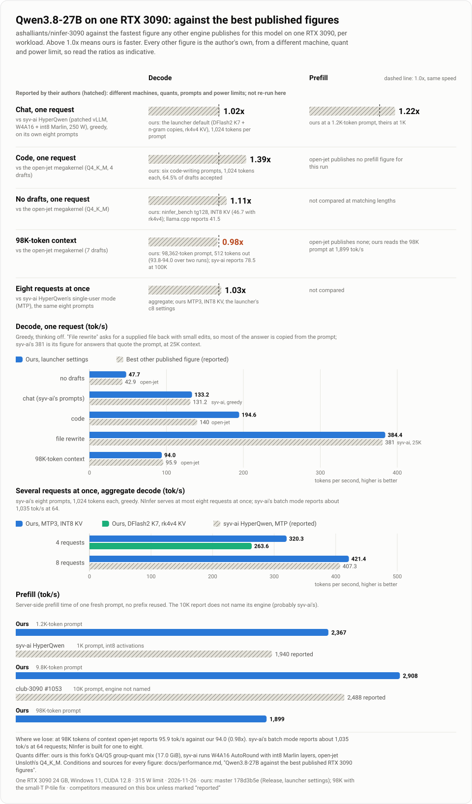
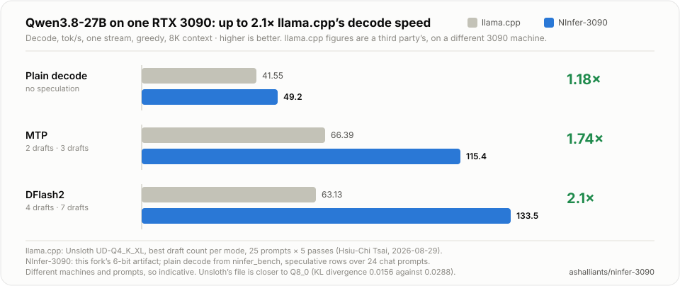
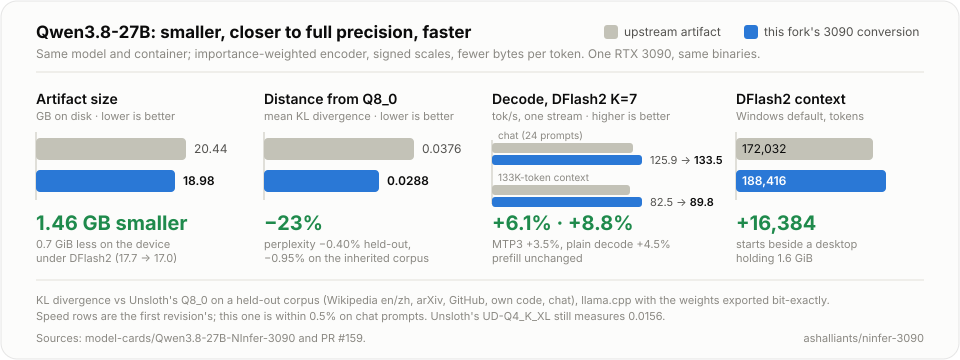
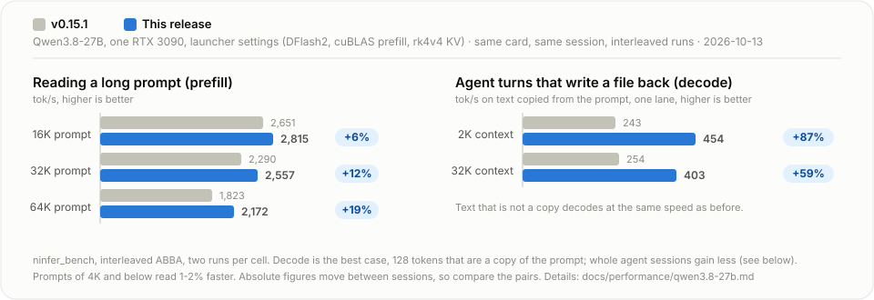
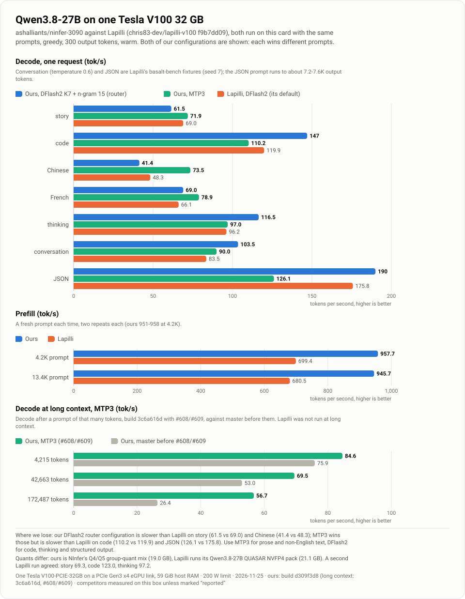

# Qwen3.8-27B for NInfer on the RTX 3090

> **Maintained at [ashalliants/ninfer-3090](https://github.com/ashalliants/ninfer-3090)**: the engine, converter and release builds these artifacts are made and tested with. Releases, issues and updates live there, and a star helps others find it.











This model card is the version-controlled source for
[WarlaxZ/Qwen3.8-27B-NInfer-3090](https://huggingface.co/WarlaxZ/Qwen3.8-27B-NInfer-3090).

The repository contains [Qwen3.8-27B](https://huggingface.co/Qwen/Qwen3.8-27B) converted to the
native `.ninfer` artifact format by the RTX 3090 fork of NInfer,
[ashalliants/ninfer-3090](https://github.com/ashalliants/ninfer-3090). It is the fork's default
27B model (`download-model qwen38-27b`). It is not a Transformers checkpoint, Safetensors
distribution or GGUF file, and it needs this fork's executables: upstream NInfer and older fork
builds refuse it at startup because they lack its 4-bit MLP down route.

## What is different from the upstream artifact

Same model, same container, a different weight encoding. Upstream's
[neroued/Qwen3.8-27B-NInfer](https://huggingface.co/neroued/Qwen3.8-27B-NInfer) rounds each
64-weight group to the nearest code with scale = absmax / qmax. This artifact uses the
`grouped_search` encoder:

- each group's FP16 scale is searched over 50 candidates, choosing the one with the least
  importance-weighted squared error, where importance is the mean squared input activation per
  channel (an imatrix);
- scales may be negative, which lets a group use the full code range (−8 for Q4, −16 for Q5);
- the layout spends fewer bytes per decoded token: a 4-bit token embedding, a 6-bit output head,
  and attention/GDN output projections and MLP down projections that are 4-bit in the early layers
  and 5-bit from layer 23 (attention output), 24 (GDN output) and 30 (MLP down).
  Everything else keeps upstream's formats (Q4 query/key/gate/up, Q5 value/z/gate/down/output).

Vision, MTP, DFlash2 and the 131,072-row proposal head are carried over with upstream's encoding.

**Revision 2026-11-16.** The first revision of this artifact (commit `d47f2732`, SHA-256 `7f2a0086…`)
gave those three roles Q5 in layers 0–35 and Q4 in 36–63. This revision reverses that: it puts the
5-bit bytes where the imatrix-weighted rounding error is largest, at the same byte count, which
lowers the KL divergence by about 9% (measurements below; pull request
[#445](https://github.com/ashalliants/ninfer-3090/pull/445)). The old file stays available at its
commit, and the `download-model` scripts of earlier releases still fetch it by that pin.

## Artifact

| Field | Value |
|---|---|
| Filename | `qwen3_8_27b.ninfer` |
| Size | 18,979,828,480 bytes (17.68 GiB); upstream's is 20,437,521,664 |
| SHA-256 | `38304957e3e8b43122ef109e05bad1e18600f8f300e3347fda3092fc51acc381` |
| Container version | 3 |
| Architecture | `Qwen3_5ForCausalLM` |
| Public model name | `qwen3.8-27b` |
| Components | text, vision, MTP, DFlash2, proposal head |
| Stored objects | 1,190 (1,184 tensors and 6 resources) |

```bash
printf '%s  %s\n' \
  '38304957e3e8b43122ef109e05bad1e18600f8f300e3347fda3092fc51acc381' \
  'qwen3_8_27b.ninfer' | sha256sum --check
```

The repository also holds `qwen3_8_27b.ninfer.conversion.json` (the converter's report: every
object, its sources, format and method) and `qwen3_8_27b.imatrix.safetensors`, the importance
matrix the encoder used, so the artifact can be rebuilt.

## Measurements

RTX 3090 (24 GB), CUDA 12.8, Windows. "Upstream" is `neroued/Qwen3.8-27B-NInfer` at
`1cbd84e7`, run with the same binaries. The first revision's quality was measured at fork commit
`66a05b72`; its speed with the small-T Q6 head kernel that followed it (`36b798c9`), which this
artifact needs to be faster under speculative decoding. The 2026-11-16 revision's quality was
measured at fork commit `8cf349f1`, together with a re-run of the first revision, and its speed
against the first revision on the same card (below).

**Quality.** `ninfer-perplexity --quick --kv-dtype int8`:

| Corpus | Upstream | First revision | This revision | Change vs upstream |
|---|---:|---:|---:|---:|
| `perplexity-1m` (inherited) | 4.3428 | 4.3025 | 4.3014 | −0.95% |
| `perplexity-heldout-2026-09` (wikipedia en/zh, arXiv, GitHub, own code, chat) | 4.3396 | 4.3169 | 4.3224 | −0.40% |

Upstream's figures are from the original measurement; the other two columns were measured together
on 2026-11-16, where the first revision lands within 0.03% of what it scored originally. On the
held-out corpus this revision is 0.13% above the first one, all of it Chinese Wikipedia (9.14 to
9.27 while arXiv, both code streams and chat improve), although that stream's KL divergence falls.

KL divergence against Unsloth's Q8_0 GGUF on the held-out corpus (8 × 4096 tokens per stream,
llama.cpp b11316 with the NInfer weights exported bit-exactly into Q8_0 blocks):

| Weights | Mean KLD |
|---|---:|
| Upstream encoding and layout | 0.0376 |
| First revision's layout with a 6-bit embedding | 0.0304 |
| First revision (4-bit embedding) | 0.0318 |
| **This revision** (4-bit embedding, Q5 from layer 23, 24 and 30) | **0.0288** |
| Unsloth UD-Q4_K_XL (llama.cpp formats, 17.56 GB of text weights) | 0.0156 |

The 4-bit embedding costs Chinese Wikipedia (0.0794 → 0.0859) and chat (0.0355 → 0.0373) against
a 6-bit one; English, arXiv and code streams are unchanged to the fourth decimal.

Per stream, this revision against the first (KL divergence, lower is better):

| Stream | First revision | This revision |
|---|---:|---:|
| wikipedia_en | 0.0182 | 0.0173 |
| wikipedia_zh | 0.0859 | 0.0732 |
| arXiv | 0.0183 | 0.0169 |
| github_code | 0.0143 | 0.0136 |
| own_code | 0.0169 | 0.0164 |
| synthetic_chat | 0.0373 | 0.0358 |

A second, never-calibrated sample (the other file of each held-out stream, same method) reads
0.0197 → 0.0183 (−6.7%) and improves every stream except synthetic_chat, which moves from −4.2% on
the first sample to +5.2% on the second. HumanEval and MBPP (421 problems, greedy, non-thinking)
gave 375 and 380 passes for the first and this revision, within noise.

Unsloth's UD-Q4_K_XL is still clearly better per byte. Their formats are not NInfer's, and
about half of the gap is their per-tensor allocation, which needs kernel routes NInfer does not
have yet.

**Speed.** `ninfer_bench`, rk4v4 KV, 8,192-token context, two interleaved rounds of three
repetitions each:

| Workload | Upstream | First revision | Change |
|---|---:|---:|---:|
| Plain decode, tg128 | 47.1 tok/s | 49.2 tok/s | +4.5% |
| Prefill, pp4096 | 1,713 tok/s | 1,727 tok/s | +0.8% |
| MTP3 + draft head, pp2048+tg256 decode | 147.4 tok/s | 151.5 tok/s | +2.8% |
| DFlash2 K=7 + draft head, pp2048+tg256 decode | 251.1 tok/s | 261.2 tok/s | +4.0% |

The bench corpus is unusually easy to draft (DFlash2 accepts 7.3 tokens per round on it), so the
speculative rows were also measured on 24 varied chat prompts through `ninfer-serve` (greedy,
thinking off, 512 tokens each, one stream):

| Profile | Upstream | First revision | Tokens per round |
|---|---:|---:|---|
| DFlash2 K=7 + draft head | 125.9 tok/s | 133.5 tok/s (+6.1%) | 3.53 → 3.57 |
| MTP3 + draft head | 111.5 tok/s | 115.4 tok/s (+3.5%) | 2.87 → 2.84 |

MTP acceptance is about 1-1.5% lower than upstream's, so its gain is smaller than DFlash2's.

The speed rows above were measured on the first revision. This revision against it, interleaved on
the same card (paired median of this over first, five or six repetitions): plain decode 1.000,
prefill 1.000, MTP3 1.000 on the bench corpus, and DFlash2 K=7 **0.972** there (7.31 accepted tokens
per round instead of 7.53, on a corpus this easy to draft). On the 24 chat prompts the draft
acceptance does not move (DFlash2 3.558 against 3.560 tokens per round, MTP3 61.40% against
61.39%) and decode is 0.996 (DFlash2) and 1.002 (MTP3) of the first revision's.
Before the small-T Q6 kernel, the 6-bit head's 8-token verify took 2.56 ms against 1.58 ms for
upstream's 8-bit head and cancelled DFlash2's gain (−0.6% on the bench); with it the head reads
at about 850 GB/s from 3 to 8 tokens.

**Against the best published figures (2026-11-26).** Through `ninfer-serve` with the launcher's
settings (DFlash2 K7 + draft head + n-gram copies, `rk4v4` KV), greedy, on one RTX 3090 under Windows
at 315 W, master `178d3b5e` (the 98K-token row with the small-T P-tile fix that followed it):

| Workload | This artifact | Best other published figure on one RTX 3090 |
|---|---:|---:|
| Code, six prompts, 1,024 tokens each | **194.6 tok/s** | 140 (open-jet megakernel, Q4_K_M) |
| Chat, syv-ai's eight prompts | **133.2 tok/s** | 131.2 (syv-ai HyperQwen, greedy) |
| No speculation (`ninfer_bench` tg128, INT8 KV) | **47.7 tok/s** | 42.9 (open-jet) |
| 98K-token context | 94.0 tok/s | **95.9** (open-jet) |
| Eight requests at once (MTP3, INT8 KV) | **421.4 tok/s** | 407.3 (syv-ai HyperQwen) |
| Prefill, 1.2K-token prompt | **2,367 tok/s** | 1,940 at 1K (syv-ai HyperQwen) |

The other figures are their authors' own, from different machines, quants and power limits. Method
and sources: [RTX 3090 comparison](https://github.com/ashalliants/ninfer-3090/blob/master/docs/performance.md#qwen38-27b-against-the-best-published-rtx-3090-figures-2026-11-26).

**Against llama.cpp.** Decode speed on one RTX 3090, one stream, greedy, 8K context. The llama.cpp
figures are not ours: they are Hsiu-Chi Tsai's
[published measurements](https://hackmd.io/@thc1006/qwen3-8-27b-speculative-decoding-rtx-3090)
(2026-08-29, Debian, i9-13900, Unsloth `UD-Q4_K_XL`, 25 prompts times 5 passes, best draft count per
mode). Ours are the rows above, on a different machine and a different prompt set, so read the ratios
as indicative rather than exact.

| Mode | llama.cpp | NInfer-3090 | Ratio |
|---|---:|---:|---:|
| Plain decode | 41.55 tok/s | 49.2 tok/s (`ninfer_bench`) | 1.18x |
| MTP | 66.39 tok/s (2 drafts) | 115.4 tok/s (3 drafts, 24 chat prompts) | 1.74x |
| DFlash2 | 63.13 tok/s (4 drafts) | 133.5 tok/s (7 drafts, 24 chat prompts) | 2.1x |

Unsloth's file is closer to Q8_0 than this artifact (KL divergence 0.0156 against 0.0288), so this
is a speed comparison, not one at equal quality. The same post notes llama.cpp's MTP output did not
match serial greedy decoding byte for byte.

**Memory.** Started back to back through `run.bat qwen38-27b` on the same desktop. The earlier
`run.bat` transcoded upstream's embedding to 4 bits at load, so the saving is smaller than the file
size difference:

| Profile | Upstream weights | This artifact | KV that fitted |
|---|---:|---:|---|
| DFlash2 (172,032 requested) | 17.7 GiB | 17.0 GiB | 150,720 → 172,224 tokens |
| MTP3, two lanes, 262,144 | 15.7 GiB | 15.3 GiB | both full; free 822 MiB → 1.19 GiB |

With the desktop holding 1.6 GiB, the DFlash2 profile starts at 188,416 tokens with 721 MiB free
and is refused at 196,608, so `run.bat` now defaults to 188,416. `run.bat` no longer passes
`--embedding-q4` or `--lm-head-q6`, which this artifact does not need; the upstream file therefore
no longer fits the default profiles.

Since 2026-11-26 the launcher profiles (all but `none`) keep only the token embedding's first 8,192
rows in VRAM and read the rest from pinned RAM (`--hot-embedding-rows 8192`): the same output bit for
bit, no measured speed change, 622 MiB more for the KV cache. That day, on a desktop holding about
1.5 GiB, the DFlash2 profile started at 188,416 with 1.48-1.61 GiB free with them and fitted to
182,272 without them; the MTP profile's two lanes at 262,144 started with 1.90 GiB free (1.17 GiB
without). With `NINFER_SPEC=mtp` and three or more lanes, each request is capped at 131,072 tokens
and the shared pool is sized to the card: on Windows 11 at the 315 W limit, 330,240 tokens at four
lanes (932 MiB free), so four 75-84K-token agent sessions with ~95% cached follow-ups all ran at
once: 119.9 tok/s aggregate against 98.7 with the earlier one-context pool (+21%), a batch of 56.7 s
against 68.9 s, and the worst first-token wait 13.4 s against 41.0 s.

**Smoke tests.** These all completed coherently:

- both `run.bat` profiles served a chat request;
- DFlash2, MTP3 and plain text generation;
- `image_chart` (`NIFER VISION 731；3；左侧`, the expected answer);
- `image_natural` (mailbox 24, sun on the right) with `--vision --vision-residency overlay`.

**Per-layer KV mixes** (opt-in, not yet measured on a 3090). `--kv-dtype rk4v4x12,int8x4` keeps
`rk4v4` in the first twelve full-attention layers and `int8` in the last four, which on a Tesla V100
halved `rk4v4`'s perplexity penalty (+1.69 against +3.56 millinats from `int8`) for 22% more KV per
token, and decoded 3% faster than `rk4v4` there. On a 24 GB card that trades context for accuracy;
see [the README](https://github.com/ashalliants/ninfer-3090#per-layer-mixes---kv-dtype-rk4v4x12int8x4-opt-in).

## Run it

Build [ashalliants/ninfer-3090](https://github.com/ashalliants/ninfer-3090), then:

```text
scripts\download-model.bat qwen38-27b
scripts\run.bat qwen38-27b
```

or on Linux `scripts/download-model.sh qwen38-27b` and `scripts/run.sh qwen38-27b`. Direct CLI use:

```bash
./build/apps/ninfer models/qwen3_8_27b.ninfer \
  --prompt "Explain prefill and decode in three sentences." \
  --max-context 32768 --kv-dtype rk4v4 \
  --spec dflash2 --draft-tokens 7 --lm-head-draft
```

DFlash2 needs `--lm-head-draft`. Its candidate top-k reads either the proposal head or the full
head, and the top-k kernel has no 6-bit route, so DFlash2 with the full 6-bit head is refused.
`--embedding-q4` and `--lm-head-q6` are accepted and do nothing here, because both tensors are
already stored in those formats.

## Provenance

| Field | Value |
|---|---|
| Source | `Qwen/Qwen3.8-27B` @ `1d4bf0f2ff6012fd82039f2fa52739d0dd7c60c0` |
| DFlash2 source | `z-lab/Qwen3.8-27B-DFlash2` @ `50307d4c4cde6860d4eee73e2547cd786fe8e8a4` |
| Importance matrix | `imatrix_unsloth.gguf` from `unsloth/Qwen3.8-27B-GGUF` @ `4ca72078` (Apache-2.0), converted with `python -m tools.convert.imatrix` |
| Recipe | `qwen3_8_27b` in `tools/convert/official_recipes.py` |
| Converter | `python -m tools.convert --model Qwen3.8-27B --recipe qwen3_8_27b --source imatrix=qwen3_8_27b.imatrix.safetensors --source dflash2=Qwen3.8-27B-DFlash2 --components text,vision,mtp,dflash2 --proposal --name qwen3.8-27b` |

[`artifact-manifest.json`](artifact-manifest.json) has the object inventory and every source hash.

## Limits

- Vision, MTP, DFlash2 and proposal-head weights use upstream's round-to-nearest encoding. The
  imatrix covers the text layers only, and the embedding and head are searched without weights.
- The imatrix is Unsloth's general calibration set, not one tuned for this engine's workloads.
- NInfer executes on one CUDA device, or splits layers across up to eight GPUs on Linux. It does
  not do CPU offload, and it does not execute generated tool calls.

## License

Apache License 2.0, matching [Qwen3.8-27B](https://huggingface.co/Qwen/Qwen3.8-27B), the DFlash2
companion weights and Unsloth's importance matrix.

---

Built and maintained by [ashalliants/ninfer-3090](https://github.com/ashalliants/ninfer-3090). Development is sponsored by [NeverMetered](https://nevermetered.com/?ref=ninfer-3090-hf), hosted Qwen3.8-27B for coding agents.
